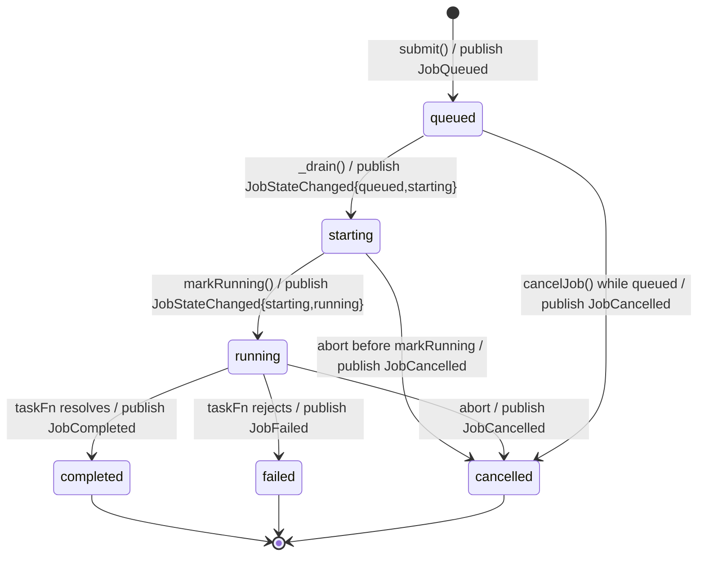
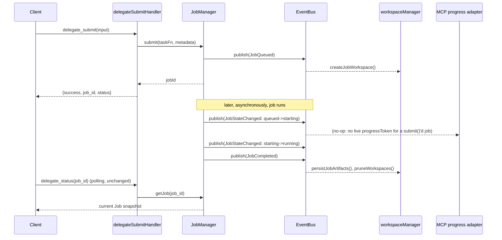

# ADR-0002: Streaming & Event Architecture

## Status
**Accepted, amended, implemented in v1.6.0** (phases 1–2, 3 partial, 4 partial, 5 — see
Migration plan for what shipped vs. what's deliberately deferred). See Amendment Log below
for what changed from the original Proposed draft and why.

## Amendment Log (Phase 0, this wave)

1. **`RuntimeEventBus` is the contract, `EventEmitter` is one implementation of it.** The
   original draft named `EventEmitter` directly in the architecture. That's an implementation
   detail — a future swap to `MessageChannel`, RxJS, Redis, NATS, or RabbitMQ must not require
   touching any publisher or subscriber. `RuntimeEventBus` is now defined as a
   `{publish, subscribe, subscribeAll}` shape (see below); the `EventEmitter`-backed default
   is one file, and it is the *only* file in the codebase allowed to `import "node:events"`.
2. **`JobStarting`/`JobRunning` collapsed into `JobStateChanged`.** A state transition and a
   progress update are different concepts (per this amendment's own instruction: "a state
   transition is not progress"), so they get different types — but not every *individual*
   transition needs its own type. `JobQueued`/`JobCompleted`/`JobFailed`/`JobCancelled` keep
   distinct types because their payloads are genuinely different shapes and consumers branch
   on them (workspace creation vs. persistence-with-result vs. persistence-with-error).
   `starting`/`running` carry no such distinct payload — they're both "the status field
   ticked," so both now emit one `JobStateChanged` with `{from, to}`. This is a real
   reduction (6 lifecycle types → 4 distinct + 1 generic), not just a rename.
3. **`StdoutReceived`/`StderrReceived` collapsed into `OutputChunk`.** Identical shape, differ
   only by which stream — `{stream: "stdout"|"stderr", chunk, timestamp}` on one type is
   simpler than two types a subscriber has to handle symmetrically anyway.
4. Net effect: 12 types → 10 (`JobQueued`, `JobStateChanged`, `JobProgress`, `OutputChunk`,
   `JobCompleted`, `JobFailed`, `JobCancelled`, `ArtifactCreated`, `WorkspaceCreated`,
   `WorkspaceDeleted`), with zero overlap — every transition emits exactly one event type,
   which is also what makes "no duplicate events" mechanically verifiable in tests.

## Context
Three separate pieces of code currently push data about a job's lifecycle to three separate
places, each wired by direct function calls:
- `JobManager._transition()` writes to `JobStore` (the state itself).
- `delegationService.submitDelegation()` directly calls `workspaceManager.createJobWorkspace()`
  and `.persistJobArtifacts()`.
- `delegate_status`/`delegate_history` handlers directly call `jobManager.getJob()`/`.listJobs()`.

This works today because there are exactly two consumers (workspace, and the read-side MCP
tools) and both are known at `JobManager`'s call sites. It does not extend to: a live
streaming consumer, a future dashboard process, telemetry, or third-party plugins — each
would require `JobManager` (or `delegationService`) to grow another direct call, which is
exactly the coupling `docs/adr/ADR-0001`'s "keep persistence independent" principle already
pushed back on once. This ADR generalizes that into a proper publish/subscribe boundary.

## Goals
- One emission point for "something happened to a job," consumed by an arbitrary number of
  subscribers without `JobManager` knowing any of them exist.
- `JobManager` remains the single source of truth for *state* — the bus carries
  *notifications*, never becomes a second place job state lives or a replayable event log.
  A consumer that missed an event can always reconcile via `jobManager.getJob(id)`.
- Zero change to any MCP tool schema or to `JobManager`'s existing public methods — event
  emission is additive instrumentation on already-existing transition points.
- A failing/slow subscriber must never affect job execution (same fail-safe principle ADR-0001
  established for workspace I/O, generalized to all future consumers).

## RuntimeEventBus contract (implementation-independent)

```
RuntimeEventBus = {
  publish(partialEvent: {type, jobId, payload}) -> RuntimeEvent   // fills eventId/timestamp/version
  subscribe(type: string, handler: (RuntimeEvent) => void) -> unsubscribe: () => void
  subscribeAll(handler: (RuntimeEvent) => void) -> unsubscribe: () => void
}
```

This is the *only* thing any other module may depend on. `src/services/runtimeEventBus.js`
exports `createRuntimeEventBus()`, whose default implementation happens to use `node:events`'
`EventEmitter` internally — but the `EventEmitter` instance is closed over, never returned or
exposed. A future implementation (`MessageChannel`, RxJS, Redis, NATS, RabbitMQ) only has to
satisfy the three-function shape above; nothing that calls `publish`/`subscribe` needs to
change.

```
                          ┌──────────────────┐
  JobManager.submit()     │                  │  subscribe   ┌────────────────────┐
  JobManager._transition()│  RuntimeEventBus │◄─────────────┤ workspaceManager    │
  claudeCliService.invoke │ (contract; default│◄─────────────┤ MCP progress adapter│
       │  publish(...)    │  impl: EventEmitter,│◄─────────────┤ future: dashboard   │
       └─────────────────►│  internal only)  │◄─────────────┤ future: plugins      │
                          └──────────────────┘                └────────────────────┘
```

- **Publishers**: `JobManager` (state transitions), `claudeCliService` (output chunks, once
  migrated to `spawn()` — see CLI Integration), `workspaceManager` (artifact/workspace
  lifecycle).
- **Subscribers**: `workspaceManager` (replacing today's direct calls — see Migration plan),
  a new MCP-progress adapter, and anything added later — none of which `JobManager` imports
  or knows about.
- **Isolation**: `subscribe()`'s returned handler is individually try/catch-wrapped inside
  `runtimeEventBus.js` — one throwing subscriber is logged and skipped, never affects sibling
  subscribers or the publisher's call stack. This lives entirely inside the bus implementation,
  not at each call site, so it holds regardless of which backing implementation is in use.
- **Backpressure**: none needed for lifecycle events (low frequency, one per state
  transition). `OutputChunk` is higher-frequency — flagged under Risks.

## Event schema (frozen by this ADR, once accepted)

```json
{
  "eventId": "uuid",
  "timestamp": "ISO-8601 string",
  "jobId": "uuid",
  "type": "JobQueued | JobStateChanged | JobProgress | OutputChunk | JobCompleted | JobFailed | JobCancelled | ArtifactCreated | WorkspaceCreated | WorkspaceDeleted",
  "version": 1,
  "payload": { "...": "shape depends on type, see below" }
}
```

`version` is the event *schema's* version (frozen at `1`), independent of `package.json`'s
version — a future breaking change to any payload shape bumps this, per the same
breaking-change discipline `FOUNDATION_FREEZE.md` already applies to MCP schemas.

| Type | Payload | Emitted from |
|---|---|---|
| `JobQueued` | `{ tool, model, effort, metadata }` | `JobManager.submit()` |
| `JobStateChanged` | `{ from, to }` — used for `queued→starting` and `starting→running` | `JobManager._transition()` |
| `JobProgress` | `{ phase, progressMessage }`, or parsed `stream-json` content once wired | `JobManager._transition()`; `claudeCliService`, post-`stream-json` |
| `OutputChunk` | `{ stream: "stdout"\|"stderr", chunk, timestamp }` | `claudeCliService.invoke()`, post-`spawn()` migration |
| `JobCompleted` | `{ finishedAt, runtimeMs, exitCode, costUsd }` | `JobManager._transition()` |
| `JobFailed` | `{ finishedAt, runtimeMs, exitCode, error }` | `JobManager._transition()` |
| `JobCancelled` | `{ finishedAt, runtimeMs }` | `JobManager._transition()` / `cancelJob()` |
| `WorkspaceCreated` | `{ path }` | `workspaceManager.createJobWorkspace()` |
| `ArtifactCreated` | `{ path }` | reserved — nothing populates `artifacts/` yet (ADR-0001) |
| `WorkspaceDeleted` | `{ path, reason: "pruned" }` | `workspaceManager.pruneWorkspaces()` |

Every job transition emits **exactly one** event type — there is no transition that fires
both a specific event and a generic one, which is what makes "no duplicate events" a
mechanically checkable test property rather than a convention.

## State transitions (unchanged state machine, now annotated with emissions)



No new states, no new transitions — `JOB_STATUS` in `models/job.js` is untouched. This ADR
only adds a `bus.publish()` call alongside each existing `_transition()`/`submit()` call.

## Sequence diagram: delegate_submit today vs. with the Event Bus



## Streaming strategy: comparison

| | Polling (today) | MCP progress notifications | Event Bus + MCP notifications |
|---|---|---|---|
| Architecture | Client re-calls `delegate_status` | Server pushes `notifications/progress` on an open request | Bus is the backbone; an adapter forwards a subset to MCP when applicable |
| Complexity | None (already built) | Low — MCP SDK supports it, but only within one tool call's lifetime | Medium — one new module, but composes with what ADR-0001 and Sprint 4 already built |
| Extensibility | Poor — every new consumer re-implements polling | Poor — tied to a single request's `progressToken`; nothing to subscribe to for out-of-band consumers | High — dashboard/telemetry/plugins subscribe independently of any MCP request |
| Backward compat | N/A, unchanged | Additive to `delegate_task` only | Additive everywhere; `delegate_submit`+polling path is untouched |
| Performance | Wastes tool-calls/tokens for the polling client | Efficient for the one call it applies to | Same efficiency, plus in-process fan-out is cheap (function calls, no I/O) |
| Dashboard fit | Would have to poll too | **Does not apply** — a dashboard isn't an MCP client holding a `progressToken` | Native fit — dashboard is just another bus subscriber |
| Plugin fit | Poor | Not applicable | Native fit — same reason |

### Recommendation: Event Bus + MCP notifications — with a scoping caveat

**Adopt the Event Bus as the architectural backbone.** It is the only option that satisfies
"Workspace/History/Streaming/Dashboard/future plugins must consume events" from a single
emission point, and it doesn't require choosing between polling and push — it's the thing
*underneath* both.

**MCP progress notifications are one subscriber, not a replacement for polling.** This is a
protocol constraint, not a design preference: `notifications/progress` is scoped to a
`progressToken` tied to one in-flight request. `delegate_task` is in-flight for its whole
blocking duration, so it can carry a `progressToken` and receive push updates from the bus.
`delegate_submit` has already returned its tool result by the time anything interesting
happens — there is no open connection to push into. **`delegate_status`/`delegate_history`
polling remains the correct mechanism for the submit/detached path**; the bus makes that
polling *richer* (live `phase`/`progressMessage`, eventually live stdout tail) without
changing its shape. Recommending pure MCP-notifications-only would be architecturally wrong
for half of this project's own tool surface; recommending pure polling would fail every
non-MCP future consumer this wave lists as a goal. The combination is the only option that
covers both.

## CLI integration: execFile → spawn migration (implemented in v1.6.0)

**Current**: `execFile(bin, args, opts, callback)` buffers stdout/stderr fully in memory,
delivers once on exit. `claudeCliService.invoke()`'s resolved shape
(`{raw, parsed, exitCode, stderr}`) is frozen (`FOUNDATION_FREEZE.md`) — this migration must
preserve it exactly; streaming is *additive* emission alongside the existing buffered result,
not a replacement for it.

**Proposed**: `spawn(bin, args, opts)` returns a `ChildProcess` with `.stdout`/`.stderr` as
readable streams.
- **Incremental stdout**: `child.stdout.on('data', chunk => { buffer += chunk; bus.publish({type: 'OutputChunk', jobId, payload: {stream: 'stdout', chunk: String(chunk), timestamp: ...}}) })`. Final `raw` is still the fully accumulated buffer — same value `execFile` would have produced.
- **Incremental stderr**: same pattern on `child.stderr`, `stream: 'stderr'`.
- **`stream-json`**: `claude --output-format stream-json` emits newline-delimited JSON events instead of one final JSON blob. With `spawn()`, each complete line can be parsed as it arrives and re-emitted as a richer `JobProgress` (e.g. "invoking Bash tool", "reading file X") — this is what makes `JobProgress`/`progressMessage` *live* instead of the static per-phase text `PHASE_INFO` provides today. Requires a line-buffering parser (a chunk boundary can split a JSON line mid-object) — not designed in detail here, flagged as an implementation-time risk below.
- **Cancellation**: `spawn()` accepts the same `signal` option `execFile()` does — `AbortController`-based cancellation carries over unchanged. `shouldCleanupProcessTree()`/`killWindowsProcessTree()` (ADR: Wave 5 hardening) operate on `child.pid` and are transport-agnostic — no change needed.
- **Process cleanup**: `spawn()` requires explicit stream teardown (`child.stdout.destroy()`, removing `'data'` listeners) on both normal exit and abort, which `execFile()` handled internally. This is new surface area for a leak if done carelessly — flagged as a risk, not solved here.

## Migration plan (phased, each phase independently shippable)

1. ✅ **Shipped.** `RuntimeEventBus` core: `runtimeEventBus.js` + `models/runtimeEvent.js`,
   `JobManager` publishes at existing transition points. Purely additive.
2. ✅ **Shipped, partially — by design.** Terminal-side persistence (`persistJobArtifacts` +
   `pruneWorkspaces`) moved to bus subscription (`workspaceEventBridge.js`). `createJobWorkspace()`
   stays a **direct call** from `delegationService`, not bus-wired: it needs the unredacted
   `ExecutionContext` (`environment`/`process.env`), which must never be duplicated into
   `JobManager`'s job record (`job.metadata` is returned verbatim in `delegate_status`'s MCP
   response — storing raw env vars there would leak secrets through the protocol, the exact
   leak `ADR-0001`'s `context.json` redaction exists to prevent at the disk layer). A
   security-motivated scope boundary found during implementation, documented in
   `delegationService.js`'s docstring.
3. ✅ **Shipped.** `execFile` → `spawn()` in `claudeCliService`, with `OutputChunk` emission
   and manually re-implemented `maxBufferBytes` enforcement (`spawn` has no native equivalent
   to `execFile`'s `maxBuffer`). 11 tests against real child processes
   (`tests/claudeCliServiceSpawn.test.js`): success, non-zero exit with/without stdout,
   abort, timeout-equivalent kill, maxBuffer, ENOENT, chunk publishing. `invoke()`'s resolved
   shape unchanged (same tests, plus the pre-existing `tests/claudeCliService.test.js` pins).
4. ✅ **Parser shipped, not activated.** `streamJsonParser.js`, unit-tested (7 tests,
   including multi-chunk line reassembly), but **not wired into the live `--output-format`
   argument** — switching that flag is a follow-up decision once verified against a real,
   logged-in CLI session (this environment cannot verify it live; shipping an unverified
   change to the argument a frozen contract depends on is not an acceptable risk).
5. ✅ **Shipped.** MCP progress-notification adapter (`mcpProgressAdapter.js`), subscribing to
   the bus and forwarding to `delegate_task`'s `progressToken` when present (verified API:
   `extra._meta.progressToken` + `extra.sendNotification({method: "notifications/progress",
   params: {progressToken, progress, message}})`). `OutputChunk` deliberately excluded from
   forwarding (too high-frequency for a protocol channel — no production subscriber exists
   for it yet at all).
6. **Out of scope for this ADR, future work**: an actual Dashboard process and a plugin API —
   both are "just" new bus subscribers per this architecture, but neither is designed here.

Each phase passes the same `FOUNDATION_FREEZE.md` gates (full suite green, Inspector schema
diff, live end-to-end call) before the next begins.

## Risk assessment

| Risk | Severity | Mitigation (design-level; implementation detail deferred) |
|---|---|---|
| Synchronous listener throws or blocks | Medium | `runtimeEventBus.js` wraps every subscriber individually, matching ADR-0001's fail-safe I/O precedent |
| High-frequency `OutputChunk` floods subscribers | Medium | Coalesce/debounce at emission time; not designed in detail here |
| `stream-json` line parsing across chunk boundaries | Medium | Line-buffering parser built and unit-tested; **not activated on the live `--output-format` flag this wave** — the exact format can't be verified against a real logged-in CLI in this environment, and guessing wrong would risk the frozen `delegate_task` response shape |
| `EventEmitter` (default impl) max-listener warnings as subscriber count grows | Low | `setMaxListeners()` on the shared internal emitter |
| `spawn()` stream teardown omitted → listener/handle leak | Medium | Explicit cleanup in both the exit callback and the abort path |
| Scope creep into implementing Dashboard/plugins now | Low (governance) | Explicitly out of scope; this ADR only freezes the bus + event contract |

## Compatibility impact
None yet — nothing in this ADR is implemented. Once accepted, phase 1 (bus + emission) is
additive and safe under `FOUNDATION_FREEZE.md`'s existing guarantees; phases 3–5 touch
`claudeCliService`'s internals but must preserve its frozen resolved-value shape.

## Alternatives considered
- **MCP notifications only** (no bus): rejected — cannot serve `delegate_submit`'s detached
  jobs or any non-MCP consumer (dashboard, plugins), both explicit goals of this wave.
- **Polling only, richer payloads**: rejected — doesn't decouple publishers from consumers;
  every new consumer still needs a bespoke hook into `JobManager`, the exact problem this ADR
  exists to solve.
- **A message-queue/external broker** (Redis pub/sub, etc.): rejected as disproportionate —
  this is a single-process, single-user local MCP server; an in-process `EventEmitter`
  satisfies every stated goal without a new runtime dependency.
