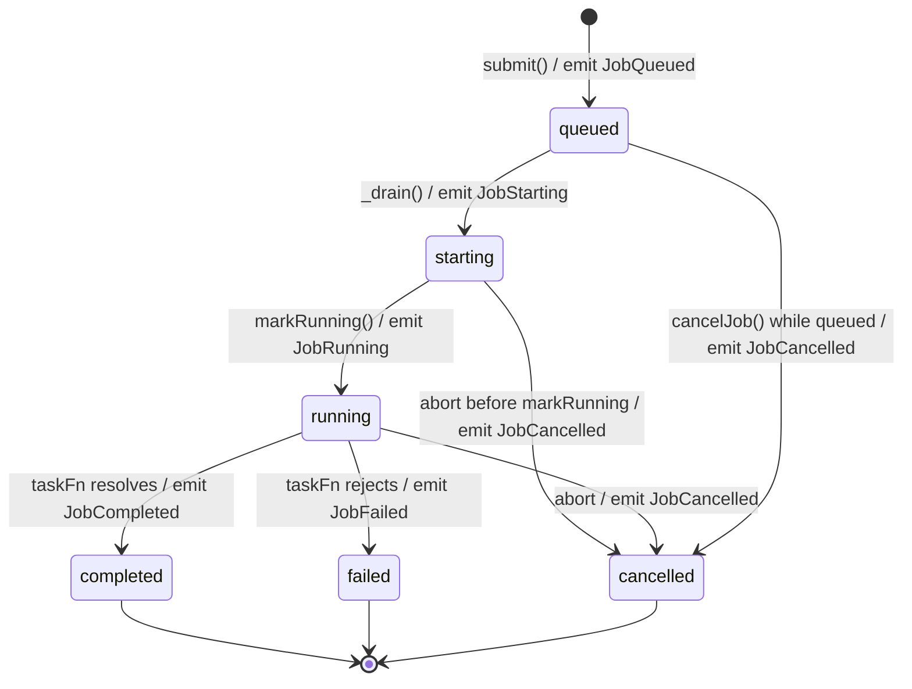
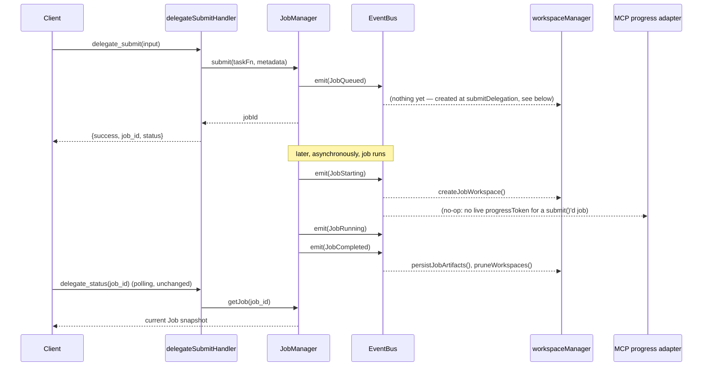

# ADR-0002: Streaming & Event Architecture

## Status
**Proposed** — design only, nothing in this document is implemented. Not yet reflected in
`docs/FOUNDATION_FREEZE.md`; it will be, once accepted and built.

## Context
Three separate pieces of code currently push data about a job's lifecycle to three separate
places, each wired by direct function calls:
- `JobManager._transition()` writes to `JobStore` (the state itself).
- `delegationService.submitDelegation()` directly calls `workspaceManager.createJobWorkspace()`
  and `.persistJobArtifacts()`.
- `delegate_status`/`delegate_history` handlers directly call `jobManager.getJob()`/`.listJobs()`.

This works today because there are exactly two consumers (workspace, and the read-side MCP
tools) and both are known at `JobManager`'s call sites. It does not extend to: a live
streaming consumer, a future dashboard process, telemetry, or third-party plugins — each
would require `JobManager` (or `delegationService`) to grow another direct call, which is
exactly the coupling `docs/adr/ADR-0001`'s "keep persistence independent" principle already
pushed back on once. This ADR generalizes that into a proper publish/subscribe boundary.

## Goals
- One emission point for "something happened to a job," consumed by an arbitrary number of
  subscribers without `JobManager` knowing any of them exist.
- `JobManager` remains the single source of truth for *state* — the bus carries
  *notifications*, never becomes a second place job state lives or a replayable event log.
  A consumer that missed an event can always reconcile via `jobManager.getJob(id)`.
- Zero change to any MCP tool schema or to `JobManager`'s existing public methods — event
  emission is additive instrumentation on already-existing transition points.
- A failing/slow subscriber must never affect job execution (same fail-safe principle ADR-0001
  established for workspace I/O, generalized to all future consumers).

## Event Bus architecture

**Reuse, don't add a dependency.** Node's built-in `node:events` `EventEmitter` is the bus.
No new package, no new abstraction layer beyond a single `src/services/eventBus.js` module
exporting one shared instance (or a factory, for test isolation — mirrors how `JobManager`
itself is already instantiated once in `mcpServer.js` and passed around).

```
                          ┌──────────────┐
  JobManager.submit()     │              │  subscribe   ┌────────────────────┐
  JobManager._transition()│  Event Bus   │◄─────────────┤ workspaceManager    │
  claudeCliService.invoke │ (EventEmitter)│◄─────────────┤ (workspace/artifact)│
       │  emit(...)       │              │◄─────────────┤ MCP progress adapter│
       └─────────────────►│              │◄─────────────┤ future: dashboard   │
                          └──────────────┘◄─────────────┤ future: plugins      │
                                                          └────────────────────┘
```

- **Publishers**: `JobManager` (state transitions), `claudeCliService` (stdout/stderr chunks,
  once migrated to `spawn()` — see CLI Integration), `workspaceManager` (artifact/workspace
  lifecycle).
- **Subscribers**: `workspaceManager` (replacing today's direct calls), a new MCP-progress
  adapter, and anything added later — none of which `JobManager` imports or knows about.
- **Isolation**: every `bus.emit()` call site wraps subscriber dispatch so a throwing listener
  is caught and logged, never propagates into the publisher's call stack. `EventEmitter`
  listeners run synchronously by default; the bus wrapper is what makes this safe, not
  `EventEmitter` itself.
- **Backpressure**: none needed for lifecycle events (low frequency, one per state
  transition). `StdoutReceived`/`StderrReceived` are higher-frequency — flagged under Risks.

## Event schema (frozen by this ADR, once accepted)

```json
{
  "eventId": "uuid",
  "timestamp": "ISO-8601 string",
  "jobId": "uuid",
  "type": "JobQueued | JobStarting | JobRunning | JobProgress | StdoutReceived | StderrReceived | JobCompleted | JobFailed | JobCancelled | ArtifactCreated | WorkspaceCreated | WorkspaceDeleted",
  "version": 1,
  "payload": { "...": "shape depends on type, see below" }
}
```

`version` is the event *schema's* version (frozen at `1`), independent of `package.json`'s
version — a future breaking change to any payload shape bumps this, per the same
breaking-change discipline `FOUNDATION_FREEZE.md` already applies to MCP schemas.

| Type | Payload | Emitted from |
|---|---|---|
| `JobQueued` | `{ tool, model, effort, metadata }` | `JobManager.submit()` |
| `JobStarting` | `{ startedAt }` | `JobManager._transition()` |
| `JobRunning` | `{}` | `JobManager._transition()` (on `markRunning()`) |
| `JobProgress` | `{ phase, progressMessage }` | `JobManager._transition()`; later, parsed `stream-json` lines |
| `StdoutReceived` | `{ chunk }` | `claudeCliService.invoke()`, post-`spawn()` migration only |
| `StderrReceived` | `{ chunk }` | same |
| `JobCompleted` | `{ finishedAt, runtimeMs, exitCode, costUsd }` | `JobManager._transition()` |
| `JobFailed` | `{ finishedAt, runtimeMs, exitCode, error }` | `JobManager._transition()` |
| `JobCancelled` | `{ finishedAt, runtimeMs }` | `JobManager._transition()` / `cancelJob()` |
| `WorkspaceCreated` | `{ path }` | `workspaceManager.createJobWorkspace()` |
| `ArtifactCreated` | `{ path }` | reserved — nothing populates `artifacts/` yet (ADR-0001) |
| `WorkspaceDeleted` | `{ path, reason: "pruned" }` | `workspaceManager.pruneWorkspaces()` |

## State transitions (unchanged state machine, now annotated with emissions)



No new states, no new transitions — `JOB_STATUS` in `models/job.js` is untouched. This ADR
only adds an `emit()` call alongside each existing `_transition()`/`submit()` call.

## Sequence diagram: delegate_submit today vs. with the Event Bus



## Streaming strategy: comparison

| | Polling (today) | MCP progress notifications | Event Bus + MCP notifications |
|---|---|---|---|
| Architecture | Client re-calls `delegate_status` | Server pushes `notifications/progress` on an open request | Bus is the backbone; an adapter forwards a subset to MCP when applicable |
| Complexity | None (already built) | Low — MCP SDK supports it, but only within one tool call's lifetime | Medium — one new module, but composes with what ADR-0001 and Sprint 4 already built |
| Extensibility | Poor — every new consumer re-implements polling | Poor — tied to a single request's `progressToken`; nothing to subscribe to for out-of-band consumers | High — dashboard/telemetry/plugins subscribe independently of any MCP request |
| Backward compat | N/A, unchanged | Additive to `delegate_task` only | Additive everywhere; `delegate_submit`+polling path is untouched |
| Performance | Wastes tool-calls/tokens for the polling client | Efficient for the one call it applies to | Same efficiency, plus in-process fan-out is cheap (function calls, no I/O) |
| Dashboard fit | Would have to poll too | **Does not apply** — a dashboard isn't an MCP client holding a `progressToken` | Native fit — dashboard is just another bus subscriber |
| Plugin fit | Poor | Not applicable | Native fit — same reason |

### Recommendation: Event Bus + MCP notifications — with a scoping caveat

**Adopt the Event Bus as the architectural backbone.** It is the only option that satisfies
"Workspace/History/Streaming/Dashboard/future plugins must consume events" from a single
emission point, and it doesn't require choosing between polling and push — it's the thing
*underneath* both.

**MCP progress notifications are one subscriber, not a replacement for polling.** This is a
protocol constraint, not a design preference: `notifications/progress` is scoped to a
`progressToken` tied to one in-flight request. `delegate_task` is in-flight for its whole
blocking duration, so it can carry a `progressToken` and receive push updates from the bus.
`delegate_submit` has already returned its tool result by the time anything interesting
happens — there is no open connection to push into. **`delegate_status`/`delegate_history`
polling remains the correct mechanism for the submit/detached path**; the bus makes that
polling *richer* (live `phase`/`progressMessage`, eventually live stdout tail) without
changing its shape. Recommending pure MCP-notifications-only would be architecturally wrong
for half of this project's own tool surface; recommending pure polling would fail every
non-MCP future consumer this wave lists as a goal. The combination is the only option that
covers both.

## CLI integration: execFile → spawn migration (design, not implemented)

**Current**: `execFile(bin, args, opts, callback)` buffers stdout/stderr fully in memory,
delivers once on exit. `claudeCliService.invoke()`'s resolved shape
(`{raw, parsed, exitCode, stderr}`) is frozen (`FOUNDATION_FREEZE.md`) — this migration must
preserve it exactly; streaming is *additive* emission alongside the existing buffered result,
not a replacement for it.

**Proposed**: `spawn(bin, args, opts)` returns a `ChildProcess` with `.stdout`/`.stderr` as
readable streams.
- **Incremental stdout**: `child.stdout.on('data', chunk => { buffer += chunk; bus.emit('StdoutReceived', {jobId, chunk}) })`. Final `raw` is still the fully accumulated buffer — same value `execFile` would have produced.
- **Incremental stderr**: same pattern on `child.stderr`.
- **`stream-json`**: `claude --output-format stream-json` emits newline-delimited JSON events instead of one final JSON blob. With `spawn()`, each complete line can be parsed as it arrives and re-emitted as a richer `JobProgress` (e.g. "invoking Bash tool", "reading file X") — this is what makes `JobProgress`/`progressMessage` *live* instead of the static per-phase text `PHASE_INFO` provides today. Requires a line-buffering parser (a chunk boundary can split a JSON line mid-object) — not designed in detail here, flagged as an implementation-time risk below.
- **Cancellation**: `spawn()` accepts the same `signal` option `execFile()` does — `AbortController`-based cancellation carries over unchanged. `shouldCleanupProcessTree()`/`killWindowsProcessTree()` (ADR: Wave 5 hardening) operate on `child.pid` and are transport-agnostic — no change needed.
- **Process cleanup**: `spawn()` requires explicit stream teardown (`child.stdout.destroy()`, removing `'data'` listeners) on both normal exit and abort, which `execFile()` handled internally. This is new surface area for a leak if done carelessly — flagged as a risk, not solved here.

## Migration plan (phased, each phase independently shippable)

1. **Event Bus core**: add `eventBus.js`, have `JobManager` emit at existing transition
   points. Purely additive — no existing caller changes. Ships alone; nothing consumes it yet.
2. **Rewire Workspace as a subscriber**: `workspaceManager`'s calls move from
   `delegationService`'s direct invocation to bus subscriptions. Internal wiring change only —
   `ADR-0001`'s public contract (`createJobWorkspace`/`persistJobArtifacts`/`pruneWorkspaces`)
   is untouched, just *called from* a different place.
3. **`execFile` → `spawn()` migration** in `claudeCliService`, with `StdoutReceived`/
   `StderrReceived` emission. `invoke()`'s resolved shape unchanged (verified by existing
   tests — `tests/claudeCliService.test.js` already pins this shape).
4. **`stream-json` parsing** for live `JobProgress`, layered on top of phase 3.
5. **MCP progress-notification adapter**, subscribing to the bus and forwarding to
   `delegate_task`'s `progressToken` when present.
6. **Out of scope for this ADR, future work**: an actual Dashboard process and a plugin API —
   both are "just" new bus subscribers per this architecture, but neither is designed here.

Each phase passes the same `FOUNDATION_FREEZE.md` gates (full suite green, Inspector schema
diff, live end-to-end call) before the next begins.

## Risk assessment

| Risk | Severity | Mitigation (design-level; implementation detail deferred) |
|---|---|---|
| Synchronous `EventEmitter` listener throws or blocks | Medium | Bus wrapper catches per-listener, matching ADR-0001's fail-safe I/O precedent |
| High-frequency `StdoutReceived` floods subscribers | Medium | Coalesce/debounce at emission time; not designed in detail here |
| `stream-json` line parsing across chunk boundaries | Medium | Line-buffering parser required; a naive per-chunk `JSON.parse` will fail intermittently |
| `EventEmitter` max-listener warnings as subscriber count grows | Low | `setMaxListeners()` on the shared bus instance |
| `spawn()` stream teardown omitted → listener/handle leak | Medium | Explicit cleanup in both the exit callback and the abort path |
| Scope creep into implementing Dashboard/plugins now | Low (governance) | Explicitly out of scope; this ADR only freezes the bus + event contract |

## Compatibility impact
None yet — nothing in this ADR is implemented. Once accepted, phase 1 (bus + emission) is
additive and safe under `FOUNDATION_FREEZE.md`'s existing guarantees; phases 3–5 touch
`claudeCliService`'s internals but must preserve its frozen resolved-value shape.

## Alternatives considered
- **MCP notifications only** (no bus): rejected — cannot serve `delegate_submit`'s detached
  jobs or any non-MCP consumer (dashboard, plugins), both explicit goals of this wave.
- **Polling only, richer payloads**: rejected — doesn't decouple publishers from consumers;
  every new consumer still needs a bespoke hook into `JobManager`, the exact problem this ADR
  exists to solve.
- **A message-queue/external broker** (Redis pub/sub, etc.): rejected as disproportionate —
  this is a single-process, single-user local MCP server; an in-process `EventEmitter`
  satisfies every stated goal without a new runtime dependency.
