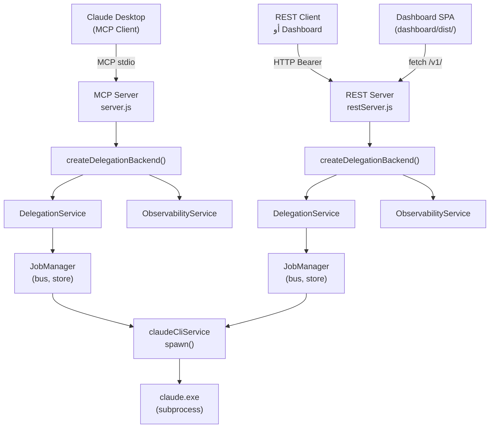
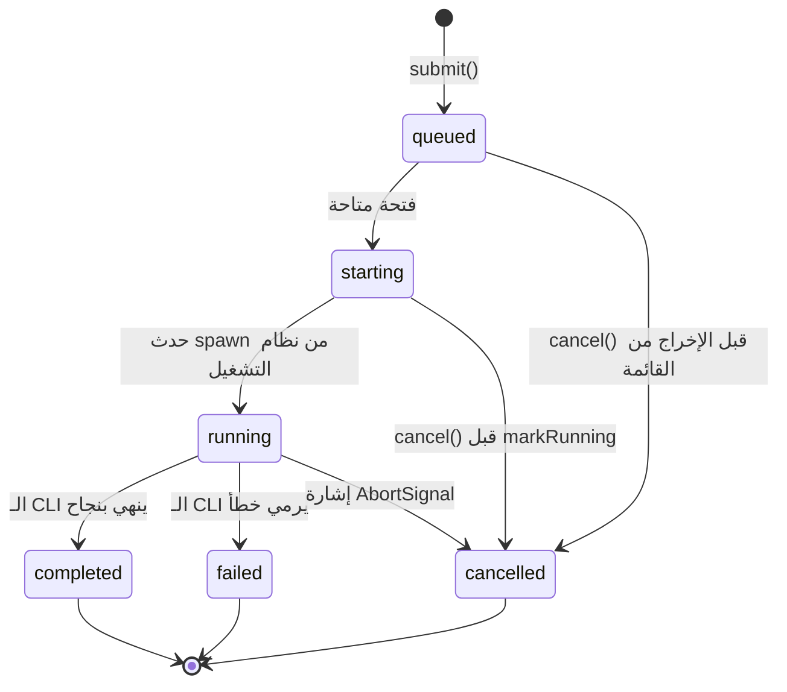
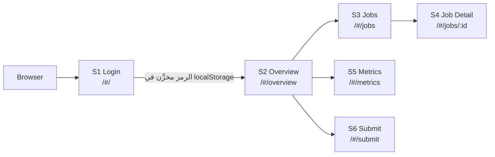

# Delegate-MCP — نظرة عامة على المشروع

> **اللغة**: [🇺🇸 English](../en/PROJECT_OVERVIEW.md) · 🇸🇦 العربية (ترجمة رسمية)
>
> **الإصدار**: v2.9.2 · **الرخصة**: Apache-2.0 · **الحالة**: معتمد بالكامل

---

## الملخص التنفيذي

Delegate-MCP هو خادم Model Context Protocol (MCP) لـ Claude Desktop يُفوِّض المهام إلى جلسة Claude Code CLI تعمل في الخلفية بوضع بدون رأس (headless). يُمكِّن الخادم الجلسة الرئيسية في Claude Desktop من إطلاق عملية Claude Code CLI مستقلة ثانية — تُسمى "المُفوَّض" — والإشراف عليها، دون الحاجة إلى مفتاح Anthropic API منفصل أو أي فوترة إضافية خارج اشتراك المستخدم الحالي في Claude.

يكشف الخادم عن تسعة أدوات MCP تغطي تقديم المهام، وإدارة دورة حياة الوظائف، واسترجاع السجل، والإلغاء، والمراقبة (Observability). اعتبارًا من الإصدار v2.8.0، أُضيف transport ثانٍ مستقل بالكامل مبني على REST يعمل جنبًا إلى جنب مع واجهة MCP ويستدعي نفس الخدمات الداخلية. اعتبارًا من v2.9.0، يُقدِّم خادم REST تطبيق React SPA مُسمَّى Dashboard يُوفِّر واجهة مشغِّل تعمل عبر المتصفح.

جميع العقود العامة — مخططات أدوات MCP، وحالات دورة حياة الوظائف، ومسارات REST، وسطح المراقبة — محجوزة ومُوثَّقة في مستندات تجميد مخصصة. يُوزَّع المشروع كخادم يعمل محليًا، يُثبَّت عبر استنساخ مستودع GitHub، وينطلق بالأوامر `node server.js` (MCP) أو `node restServer.js` (REST + Dashboard).

---

## المشكلة

يُشغِّل Claude Desktop جلسة ذكاء اصطناعي تفاعلية واحدة. يمكن لهذه الجلسة إصدار التعليمات وتحليل الكود واستدعاء أدوات MCP — لكنها لا تستطيع أصلًا إطلاق عملية Claude Code CLI ثانية، أو تتبع تقدمها، أو فحص مخرجاتها، أو إلغاؤها عند الطلب.

بدون Delegate-MCP، الطريقة الوحيدة لتشغيل مهمة Claude Code في الخلفية هي فتح محطة طرفية منفصلة، وتنفيذ الأمر `claude -p "..."` يدويًا، والانتظار. لا توجد طريقة منظمة لـ:

- تقديم موجّه (prompt) إلى الـ CLI والحصول على معرّف وظيفة (job identifier) فورًا.
- الاستطلاع (polling) للحصول على الحالة أثناء تشغيل الـ CLI.
- إلغاء وظيفة قيد التنفيذ.
- فحص ما أنتجه الـ CLI دون مغادرة جلسة Claude Desktop.
- كشف سجل الوظائف أو المقاييس الحية (live metrics) أو بيانات الإعادة (Replay) لمستهلكين آخرين.

يملأ Delegate-MCP هذه الفجوة بأن يعمل كغلاف منظم وقابل للمراقبة حول ملف `claude` الثنائي المثبَّت مسبقًا على جهاز المستخدم.

---

## الفكرة الأساسية

الفكرة الجوهرية هي طبقة تنفيذ مستقلة عن وسيلة النقل (transport-agnostic) مع مسارَي تقديم ومخزن وظيفة واحد.

```
Claude Desktop (MCP client)
        │
        │  MCP stdio transport
        ▼
  Delegate-MCP (server.js)
        │
        ├─ DelegationService.submit() ─► JobManager ─► claudeCliService.invoke()
        │                                    │
        │                                    ▼
        │                              claude.exe (subprocess)
        │
        └─ ObservabilityService (مستهلك قراءة فقط من الـ bus)
```

كلٌّ من أدوات MCP وواجهة REST API تستدعي نفس الخدمتين الداخليتين:

- **`DelegationService`** — جانب الكتابة: تقديم الوظائف، والجلب، والقائمة، والإلغاء.
- **`ObservabilityService`** — جانب القراءة: المقاييس، والمخطط الزمني (timeline)، والإعادة (Replay)، واللقطة (Snapshot).

يوجد مسار كتابة واحد بالضبط إلى مخزن الوظائف (`JobManager.submit()` → `_run()` → `_transition()`). لا يتجاوزه أي مكوِّن. لا يشارك أي مكوِّن حالة الوظيفة عبر العمليات (processes) بشكل افتراضي.

---

## البنية المعمارية عالية المستوى



الحقائق المعمارية الرئيسية:

- MCP وREST هما **عمليتان منفصلتان** (separate processes) بشكل افتراضي. كل منهما يستدعي `createDelegationBackend()` بشكل مستقل ويحصل على `JobManager` وناقل الأحداث (event bus) و`ObservabilityService` الخاص به. لا يتشاركان الحالة في الذاكرة.
- يُقدَّم تطبيق Dashboard SPA مباشرةً من خادم REST على المسار `/dashboard/` — وهو تطبيق React ثابت يستدعي نقاط نهاية REST على المسار `/v1/`.
- تُطلق `claudeCliService` ملف `claude.exe` **بدون shell** — لا يُفسَّر `prompt` بواسطة shell أبدًا بغض النظر عن محتواه.

---

## التنفيذ الشامل من البداية إلى النهاية

### المسار المتزامن (`delegate_task`)

1. يستدعي Claude Desktop أداة `delegate_task` مع `prompt` وخيارات اختيارية مثل `model` و`effort` و`workingDirectory` و`allowedTools` و`timeoutMs` و`maxBudgetUsd`.
2. يتحقق المُعالج (handler) من المدخلات عبر `DelegateTaskInputSchema` (باستخدام مكتبة zod).
3. تبني `DelegationService.submit()` كائن `ExecutionContext` وتستدعي `JobManager.submit()`.
4. ينشئ `JobManager` وظيفة `Job` (الحالة: `queued`)، ويضعها في قائمة الانتظار، ويُعيد `job_id` فورًا.
5. تستدعي `delegate_task` الدالة `jobManager.waitForCompletion(job_id)` وتنتظر.
6. عند توفر فتحة تزامن (concurrency slot)، يُخرج `JobManager` الوظيفة من القائمة (الحالة: `starting`) ويستدعي `claudeCliService.invoke()`.
7. عند استقبال حدث `spawn` من نظام التشغيل، تنتقل الوظيفة إلى حالة `running`.
8. تقرأ `claudeCliService` أجزاء (chunks) من stdout بتنسيق `--output-format stream-json`، وتحللها بشكل تدريجي، وتنشر أحداث `JobProgress` على `RuntimeEventBus`.
9. عند الانتهاء، تنتقل الوظيفة إلى `completed` (أو `failed`)، يتحل `waitForCompletion`، وتُعيد `delegate_task` نتيجة الـ CLI إلى Claude Desktop.

### المسار غير المتزامن (`delegate_submit`)

الخطوات 1-4 متطابقة. في الخطوة 5، تُعيد `delegate_submit` فورًا القيمة `{success: true, job_id, status}` دون انتظار. يستخدم المستدعي `delegate_status` للاستطلاع، و`delegate_cancel` للإلغاء.

---

## دورة حياة الطلب الداخلي



**ثوابت الحالة:**

- يُضبط `startedAt` مرة واحدة (عند `starting`) ولا يُعاد ضبطه أبدًا.
- الحالات النهائية (`completed` و`failed` و`cancelled`) غير قابلة للتغيير. دائمًا تُعيد `cancelJob()` على وظيفة في حالة نهائية القيمة `false`.
- يُحسب `runtimeMs` بشكل حي للوظائف غير النهائية (`Date.now() - startedAt`)، ويتجمد عند الوصول لحالة نهائية.
- يحتجز السجل ما يصل إلى `maxJobHistory` وظيفة (الافتراضي 500). تُطرد الوظائف النهائية فقط؛ الوظائف قيد التنفيذ لا تُطرد أبدًا.

---

## Dashboard

Dashboard هو تطبيق React 18 SPA (Single Page Application) يُقدَّم من خادم REST على المسار `GET /dashboard/*`. يُوفِّر واجهة مشغِّل تعمل عبر المتصفح للوصول إلى REST API.



| الشاشة | المسار (Route) | استدعاء REST الرئيسي |
|--------|----------------|----------------------|
| S1 Login | `/#/` | — (إدخال الرمز فقط) |
| S2 Overview | `/#/overview` | `GET /v1/snapshot` (استطلاع كل 5 ث) + `GET /v1/models` (مرة واحدة) |
| S3 Jobs | `/#/jobs` | `GET /v1/jobs?status=&limit=` (استطلاع كل 5 ث) |
| S4 Job Detail | `/#/jobs/:id` | `GET /v1/jobs/:id` (استطلاع كل 2 ث) + `DELETE /v1/jobs/:id` + `GET /v1/jobs/:id/replay` |
| S5 Metrics | `/#/metrics` | `GET /v1/metrics` (استطلاع كل 5 ث) |
| S6 Submit | `/#/submit` | `POST /v1/jobs` |
| S7 Models | `/#/models` | `GET /v1/models` (مرة واحدة) |

**Authentication:** يُدخَل رمز Bearer مرة واحدة في شاشة Login ويُخزَّن في `localStorage` تحت المفتاح `delegate-rest-token`. يُحقَن كـ `Authorization: Bearer <token>` في كل استدعاء API. عند تلقي استجابة `401`، يمسح العميل الرمز ويُعيد التوجيه إلى Login.

**الثابت الأمني (RC6):** جميع حقول النص التي تُنتجها الوظائف — النتيجة، والخطأ، و`progressMessage`، و`promptPreview`، والمرحلة (phase)، والبيانات الوصفية (metadata) — تُصيَّر كنص عادي عبر JSX في React (`textContent`). لا يُستخدم `innerHTML` أو `dangerouslySetInnerHTML` في أي مكان داخل `dashboard/src/`. يسري هذا القيد على كل شاشة وكل إصدار.

**التقديم الثابت:** يُعالَج المسار `GET /dashboard/*` قبل بوابة Authentication في REST — تُقدَّم الأصول الثابتة بشكل مقصود دون مصادقة. يُضخ الـ stub الخاص بالإعداد على المسار `GET /dashboard/config.js` قيمة `window.__DELEGATE_REST__` (URL الأساسي) قبل تحميل `main.jsx`.

**البناء:** Dashboard هو بناء Vite (`npm --prefix dashboard run build`). مجلد `dashboard/dist/` غير مُلتزَم به في git (راجع ADR-0012).

---

## REST API

REST API هو وسيلة النقل الثانية، أُدخلت في v2.8.0 (ADR-0011). هي اختيارية بالكامل — خادم REST (`node restServer.js`) عملية منفصلة عن خادم MCP (`node server.js`).

المسار الأساسي: `/v1`. جميع الاستجابات: `application/json`. Authentication: مطلوب `Authorization: Bearer <token>` على كل مسار بما فيها القراءة.

### جدول المسارات (محجوز)

| الطريقة | المسار | استدعاء الخدمة | رموز الحالة | ملاحظات |
|---------|--------|---------------|-------------|---------|
| `POST` | `/v1/jobs` | `delegationService.submit()` | 202 | يُعيد `{job_id, status}` + رأس `Location` |
| `GET` | `/v1/jobs/:id` | `delegationService.getJob(id)` | 200, 404 | `Retry-After: 2` أثناء الحالة غير النهائية |
| `GET` | `/v1/jobs` | `delegationService.listJobs({status, limit})` | 200 | `limit` الافتراضي 20، الحد الأقصى 500 |
| `DELETE` | `/v1/jobs/:id` | `delegationService.cancelJob(id)` | 200, 404, 409 | 409 = نهائية بالفعل |
| `GET` | `/v1/jobs/:id/replay` | `observabilityService.replay(id)` | 200 دائمًا | لا 404 أبدًا؛ المصدر (source) قد يكون `"unavailable"` |
| `GET` | `/v1/jobs/:id/timeline` | `observabilityService.getTimeline(id, {type, since})` | 200 | لا حقل `source`؛ REST حصرًا (لا مرآة MCP) |
| `GET` | `/v1/metrics` | `observabilityService.getMetrics()` | 200 | نطاق العملية الواحدة |
| `GET` | `/v1/snapshot` | `observabilityService.getSnapshot()` | 200 | نقطة زمنية محددة |
| `GET` | `/v1/models` | `buildModelsInfo(config)` | 200 | `{models, efforts, defaults}` |

**`POST /v1/jobs` دائمًا غير متزامن.** لا يوجد ما يعادل سلوك `delegate_task` الحاجب في REST. يقوم المستدعون باستطلاع `GET /v1/jobs/:id` ومراعاة رأس `Retry-After: 2`.

### نموذج الخطأ (محجوز)

شكل JSON واحد عبر كل المسارات: `{error: {code, message, details?}}`.

| الحالة | الرمز | الكود |
|--------|-------|-------|
| معرّف وظيفة غير موجود | 404 | `JOB_NOT_FOUND` |
| مسار غير موجود | 404 | `NOT_FOUND` |
| الوظيفة في حالة نهائية بالفعل | 409 | `JOB_NOT_CANCELLABLE` |
| جسم الطلب غير صالح (zod) | 400 | `INVALID_INPUT` |
| معامل استعلام (query param) خاطئ | 400 | `INVALID_QUERY_PARAM` |
| JSON مشوَّه | 400 | `MALFORMED_BODY` |
| الجسم > 1 MiB | 413 | `PAYLOAD_TOO_LARGE` |
| رمز مفقود أو خاطئ | 401 | `UNAUTHORIZED` |
| خطأ داخلي | 500 | `INTERNAL_ERROR` |

**Authentication:** يُولَّد الرمز عند التشغيل الأول إذا لم يكن موجودًا، يُحفظ في `.delegate-rest-token`، ويُقارَن باستخدام `crypto.timingSafeEqual`. مطلوب على كل مسار.

---

## بروتوكول MCP

ينفِّذ Delegate-MCP بروتوكول Model Context Protocol (MCP) عبر وسيلة نقل stdio. يتصل Claude Desktop عبر ملف `claude_desktop_config.json` الذي يُشير إلى `server.js`.

### تسع أدوات MCP (محجوزة)

| الأداة | النوع | الوصف |
|--------|-------|-------|
| `delegate_task` | حاجب (Blocking) | تقديم موجّه، انتظار الاكتمال، إعادة النتيجة |
| `delegate_submit` | غير حاجب | تقديم موجّه، إعادة job_id فورًا |
| `delegate_status` | قراءة | الحصول على الحالة الحالية للوظيفة |
| `delegate_history` | قراءة | قائمة الوظائف مع فلتر اختياري للحالة/الحد |
| `delegate_cancel` | كتابة | إلغاء وظيفة في قائمة الانتظار أو قيد التشغيل |
| `delegate_models` | قراءة | استنتاج النماذج المتاحة والجهود والإعدادات الافتراضية |
| `delegate_replay` | قراءة | إعادة بناء سجل الأحداث الكامل لوظيفة |
| `delegate_metrics` | قراءة | استرجاع المقاييس التراكمية للعملية |
| `delegate_snapshot` | قراءة | الحصول على لقطة من المقاييس + الوظائف النشطة في لحظة زمنية |

**مخطط المدخلات (مشترك بين `delegate_task` و`delegate_submit`):**

| الحقل | النوع | الافتراضي | ملاحظات |
|-------|-------|-----------|---------|
| `prompt` | string | مطلوب | نص حر؛ لا يُفسَّر بواسطة shell أبدًا |
| `model` | string | الافتراضي من الإعداد | معرّف نموذج Claude |
| `effort` | enum | الافتراضي من الإعداد | `low` / `normal` / `high` |
| `workingDirectory` | string | `process.cwd()` | مجلد العمل لجلسة الـ CLI |
| `allowedTools` | string[] | — | قائمة السماح لأدوات MCP في الجلسة المُفوَّضة |
| `trustAll` | boolean | false | مكافئ لـ `--dangerously-skip-permissions` |
| `timeoutMs` | number | الافتراضي من الإعداد | مهلة الوظيفة بالميلي ثانية |
| `maxBudgetUsd` | number (موجب) | — | حد الإنفاق؛ تُرفض القيم الصفرية أو السالبة بواسطة zod |
| `metadata` | object | — | سياق يُوفِّره المستدعي، يُعاد في `delegate_status` |

---

## تكامل Claude Code CLI

يستدعي Delegate-MCP ملف `claude` الثنائي عبر `spawn()` في Node.js. التكامل مع الـ CLI محصور بالكامل في `src/services/claudeCliService.js`.

**بناء الوسائط:**

- `--print` — وضع غير تفاعلي (مكافئ لـ `claude -p`)
- `--output-format stream-json --verbose` — مطلوب للتقدم التدريجي
- `--model <model>` — من `ExecutionContext.model`
- `--max-turns 1` — يمنع الـ CLI من طلب مدخلات إضافية
- وسائط الميزانية والجهد وقائمة الأدوات المسموح بها ومشعل الثقة من `ExecutionContext`

**تحليل Stream:** يُخرج الـ CLI تنسيق `stream-json`: كائن JSON واحد لكل سطر. تُخزِّن `claudeCliService.js` الأجزاء (chunks) بشكل تدريجي عبر `streamJsonParser.js` وتُصنِّف الأحداث:

- `system/thinking_tokens` → `JobProgress` ("Thinking… (~N tokens)")
- `assistant` مع كتلة محتوى `text` → `JobProgress` (نص الاستجابة)
- `type:"result"` → النتيجة النهائية، متطابقة حقلًا بحقل مع تنسيق `json` القديم غير المتدفق
- جميع الأحداث الأخرى (الخطافات، إدارة الجلسة، `tool_use`، الأشكال غير المعروفة) → تُتجاهل بصمت

شكل استجابة `delegate_task` لا يتأثر بوسيلة نقل البث — يتلقى المستدعون دائمًا نفس هيكل النتيجة `{isError, content, structuredContent}`.

**لا shell:** تُطلق `claudeCliService.invoke()` ملف `config.claudeBin` مباشرةً مع `shell: false`. يجب أن يُشير `config.claudeBin` إلى ملف `claude.exe` الحقيقي، لا إلى shim من نوع `.cmd`/`.bat`. كان استخدام shell سيُعيد تحليل `prompt` بحثًا عن المحارف الخاصة (`&`، `|`، `` ` ``) — وهو ناقل حقن أوامر (command injection).

**حماية من الـ Buffer:** تُطبِّق `spawnAndCollect()` حد `config.maxBufferBytes` يدويًا على كل جزء. تُقتل عملية الطفل فور تجاوز stdout أو stderr للحد.

**تنظيف شجرة العملية على Windows:** عند الإلغاء أو المهلة، يُنفَّذ `taskkill /t /f` على شجرة العملية المُطلقة لقتل أي عمليات أحفاد (مثل استدعاءات أداة Bash لا تزال تعمل عند إلغاء الوظيفة).

---

## نموذج الأمان

خصائص الأمان بنيوية — مُطبَّقة بواسطة الكود، لا بالاتفاق.

| الخاصية | الآلية | الموقع |
|---------|--------|--------|
| لا حقن shell | `spawn(bin, args, {shell: false})` — `prompt` هو إدخال argv حرفي واحد | `claudeCliService.js` |
| سلامة المسار | فحص UUID عبر `isValidJobId()` قبل أي دمج مسار نظام ملفات | `workspaceManager.js` |
| إخفاء الأسرار | `ExecutionContext.environment` (= `process.env`) لا يُكتب على القرص أو في استجابة MCP | `delegationService.js`, `workspaceManager.js` |
| مصادقة آمنة زمنيًا | `crypto.timingSafeEqual()` لمقارنة رمز Bearer | `src/rest/auth.js` |
| المصادقة قبل التوجيه | وجود المسار غير قابل للملاحظة من قِبل المستدعين غير المُصادَق عليهم | `src/rest/restServer.js` |
| لا XSS في Dashboard | جميع نصوص الوظائف تُصيَّر عبر JSX في React (`textContent`)؛ `innerHTML`/`dangerouslySetInnerHTML` غائبان من `dashboard/src/` | الثابت RC6، قائمة تدقيق PR |
| حماية من فيض الـ Buffer | فحص `maxBufferBytes` على كل جزء من stdout/stderr؛ تُقتل العملية الطفل عند التجاوز | `claudeCliService.js` |
| Observability للقراءة فقط | `ObservabilityService` لا يحتفظ بمرجع إلى `JobManager` أو الـ CLI أو `bus.publish` | `observabilityService.js` |
| تنظيف شجرة العملية على Windows | `taskkill /t /f` عند الإلغاء/المهلة (win32 فقط) | `claudeCliService.js` |

---

## نظام Replay (إعادة التشغيل)

يُعيد نظام Replay بناء سجل الأحداث الكامل لوظيفة ما في وضع القراءة فقط. يُكشف عبر:

- **MCP**: أداة `delegate_replay`
- **REST**: `GET /v1/jobs/:id/replay`

يُحاول `ReplayEngine.replay(jobId)` ثلاث مستويات بالترتيب:

```
1. runtime  — TimelineStore (في الذاكرة، أحدث الوظائف، دقة كاملة)
      ↓
2. durable  — EventHistoryStore (<job-id>.jsonl، اختياري عبر CLAUDE_DELEGATE_EVENT_HISTORY=file)
      ↓
3. workspace — metadata.json (تقريبي، synthetic: true، يعيش بعد إعادة التشغيل)
      ↓
4. unavailable — الوظيفة لم توجد أو تم حذف workspace
```

تتضمن الاستجابة دائمًا حقل `source` يُشير إلى المستوى المستخدم. مصفوفة `timeline` هي نفس شكل `RuntimeEvent[]` بغض النظر عن المستوى. إدخالات workspace الاصطناعية مُعلَّمة بـ `synthetic: true`.

**Replay الدائم:** عند تفعيل `CLAUDE_DELEGATE_EVENT_HISTORY=file`، يُلحق `EventHistoryStore` كل `RuntimeEvent` في ملف `<job-id>.jsonl` خاص بكل وظيفة. يُوفِّر هذا إعادة تشغيل كاملة الدقة لأي وظيفة تم تسجيلها، حتى بعد إعادة تشغيل العملية أو خروج الوظيفة من نافذة احتفاظ `TimelineStore`.

---

## المراقبة (Observability)

`ObservabilityService` هو مستهلك سلبي للقراءة فقط من `RuntimeEventBus`. لا يمكنه تغيير حالة الوظيفة، ولا إلغاء وظيفة، ولا تنفيذ أي شيء — قاعدة المراقبة السلبية (Passive Observation Rule) بنيوية: لا يحتفظ بمرجع إلى `JobManager` أو `claudeCliService` أو `bus.publish`.

تُوفِّر الخدمة أربعة أساليب:

| الأسلوب | المستهلك | البيانات |
|---------|---------|---------|
| `getMetrics()` | `delegate_metrics`، `GET /v1/metrics` | تجميعات تراكمية O(1) منذ التشغيل |
| `getTimeline(id, opts)` | `GET /v1/jobs/:id/timeline` (REST فقط) | قائمة أحداث محدودة لكل وظيفة |
| `replay(id)` | `delegate_replay`، `GET /v1/jobs/:id/replay` | إعادة بناء الأحداث بالكامل |
| `getSnapshot()` | `delegate_snapshot`، `GET /v1/snapshot` | `{takenAt, metrics, activeJobs}` في لحظة محددة |

**المقاييس** هي تجميعات تراكمية O(1) — لا مصفوفات سجل مُخزَّنة. تحسب `MetricsCollector` حجم workspace وعدد القطع الأثرية (artifacts) من القرص عند الطلب (فقط عند استدعاء `getMetrics()`)، مع إعادة استخدام `workspaceManager.getWorkspaceRoot()`.

**اللقطات** هي `structuredClone()` + `Object.freeze()` بشكل متكرر. غير قابلة للتغيير بمجرد إعادتها. `activeJobs` مُشتقة من `MetricsCollector.getActiveJobs()` (مُستمدة من الأحداث، لا من استعلام `JobManager`).

**نطاق العملية:** المقاييس واللقطات محدودة بنطاق العملية التي جمعتها. تراكم عملية REST وعملية MCP عدادات مقاييس مستقلة — لا يوجد تجميع عبر العمليات.

---

## قرارات المعمارية (ADRs)

تحكم اثنا عشر ADR معمارية المشروع. كل منها يمثل قرارًا مُراجَعًا ومقبولًا:

| ADR | العنوان | القرار الرئيسي |
|-----|---------|---------------|
| ADR-0001 | Workspace and Artifact Architecture | سجل قطع أثرية على القرص لكل وظيفة؛ workspace للكتابة مرة واحدة فقط، لا صلاحية عليه |
| ADR-0002 | Streaming and Event Architecture | `RuntimeEventBus` كعمود فقري للأحداث؛ `stream-json` لمخرجات الـ CLI |
| ADR-0003 | Observability Architecture | قاعدة المراقبة السلبية؛ `ObservabilityService` لا يحتفظ بمراجع كتابة |
| ADR-0004 | Server Instance Lifecycle | إغلاق stdin كمُشغِّل ثالث للإغلاق السلس |
| ADR-0005 | Persistent Job Store | `FileJobStore` كبديل اختياري لـ `InMemoryJobStore` |
| ADR-0006 | Persistent Event History | `EventHistoryStore` (`<job-id>.jsonl`) للـ Replay الكامل الدقة والدائم |
| ADR-0007 | MCP Replay Access | `delegate_replay` كمحوِّل نقل رفيع فوق `replay()` |
| ADR-0008 | MCP Metrics Access | `delegate_metrics` كمحوِّل نقل رفيع فوق `getMetrics()` |
| ADR-0009 | MCP Snapshot Access | `delegate_snapshot` كمحوِّل نقل رفيع فوق `getSnapshot()` |
| ADR-0010 | Unified Access Layer | `DelegationService` + `ObservabilityService` كواجهتَي API الداخليتَين الثابتتَين |
| ADR-0011 | REST API Foundation | وسيلة نقل REST اختيارية؛ نفس الخدمتَين؛ تسعة مسارات محجوزة |
| ADR-0012 | Dashboard Stage 3 | React SPA مُقدَّم من خادم REST؛ استطلاع (polling) لا SSE؛ الثابت الأمني RC6 |

---

## ما ليس عليه Delegate-MCP

| الادعاء | الواقع |
|---------|--------|
| قائمة انتظار مهام موزَّعة | عملية واحدة، جهاز واحد. لا تجميع. لا مشاركة وظائف عبر العمليات بشكل افتراضي. |
| نظام متعدد المستخدمين | رمز Bearer واحد. أي مستدعٍ يملك الرمز يمكنه رؤية وإلغاء أي وظيفة. |
| بديل مفتاح API | يتطلب تثبيت الـ CLI وتسجيل الدخول باشتراك المستخدم. لا مسار مفتاح Anthropic API. |
| خادم استجابات متدفقة | لا SSE. يستطلع عملاء REST المسار `GET /v1/jobs/:id` بإيقاعهم الخاص. |
| نظام أولوية التخزين الدائم | مخزن الوظائف في الذاكرة بشكل افتراضي. التخزين الدائم اختياري عبر `CLAUDE_DELEGATE_JOB_STORE=file`. |
| حزمة npm | `"private": true`. يُوزَّع عبر استنساخ GitHub، لا عبر سجل npm. غير مناسب كاعتمادية. |
| وسيط أو ترحيل (Relay) | يُقدِّم الطلبات مباشرةً إلى ملف `claude` الثنائي المحلي. لا يستدعي Anthropic HTTP API. |
| خدمة إنتاج (Production Service) | لا تجميع، لا توافر عالٍ، لا مصادقة متعددة المستأجرين، لا تحديد معدل. مصمَّم للاستخدام المحلي من قِبل مشغِّل واحد. |

---

## حالات الاستخدام النموذجية

**1. تفويض مهمة تحليل طويلة**

تحتاج الجلسة الأساسية في Claude Desktop إلى تشغيل تحليل قاعدة بيانات كبير قد يحجب نافذة سياقها. تستدعي `delegate_submit` مع موجّه التحليل، تتلقى `job_id`، تواصل عملها الخاص، ثم تستطلع `delegate_status` حتى تصبح الوظيفة `completed`، وتسترجع النتيجة.

**2. تشغيل مهام خلفية متوازية**

يسمح `JobManager` بتشغيل ما يصل إلى `maxConcurrentJobs` (الافتراضي 2) مهمة في وقت واحد. يمكن لجلسة منسِّقة تقديم استدعاءات `delegate_submit` متعددة واستخدام `delegate_history` لتتبع كل الوظائف قيد التنفيذ.

**3. مراقبة مهمة جارية عبر Dashboard**

يفتح المشغِّل Dashboard على `http://localhost:8787/dashboard/`. بعد إدخال رمز Bearer على شاشة Login، يتنقل إلى قائمة الوظائف لمشاهدة الوظائف الجارية، يفتح Job Detail لرؤية رسائل التقدم الحية ومخطط Replay الزمني، ويُلغي الوظائف عند الحاجة.

**4. فحص الوظائف السابقة عبر Replay**

بعد اكتمال وظيفة، يستدعي المشغِّل `delegate_replay` (عبر MCP أو `GET /v1/jobs/:id/replay` عبر REST) لرؤية المخطط الزمني الكامل للأحداث — `JobQueued`، `JobStarted`، `JobProgress` (رموز التفكير، نص الاستجابة)، `JobCompleted`. مع تفعيل `CLAUDE_DELEGATE_EVENT_HISTORY=file`، يكون Replay متاحًا حتى بعد إعادة تشغيل العملية.

**5. تكامل REST API في سكريبت أو CI pipeline**

يُقدِّم سكريبت خارجي وظيفة عبر `POST /v1/jobs`، يستطلع `GET /v1/jobs/:id` حتى الحالة النهائية، يقرأ حقل `result` من `JobView`، ثم ينهي تنفيذه. السكريبت لا يتفاعل مع Claude Desktop مباشرةً.

---

## هيكل المستودع

```
claude-delegate-mcp/
│
├── server.js               نقطة دخول MCP (stdio transport)
├── restServer.js           نقطة دخول REST (HTTP transport)
│
├── src/
│   ├── cli/
│   │   ├── entry.js        تشغيل MCP: تحميل الإعداد، الفحص، البدء، الإغلاق
│   │   └── restEntry.js    تشغيل REST: main()، buildRouteTable()، معالجات الإغلاق
│   │
│   ├── server/
│   │   ├── mcpServer.js    نسخة McpServer؛ تسجيل 9 أدوات MCP
│   │   └── health.js       فحص غير حاجب لوجود ملف claude الثنائي
│   │
│   ├── handlers/           ملف واحد لكل أداة MCP (تحقق من المدخلات → استدعاء الخدمة → الاستجابة)
│   │
│   ├── rest/
│   │   ├── restServer.js   خط أنابيب الطلبات: dashboard → body-limit → auth → route → handler
│   │   ├── router.js       مُطابق مسار نقي (لا إدخال/إخراج)
│   │   ├── auth.js         فحص رمز Bearer + توليد/تخزين
│   │   ├── bodyLimit.js    فحص Content-Length المسبق
│   │   ├── errors.js       تعيين خطأ موحَّد
│   │   ├── parsing.js      التحقق من معاملات الاستعلام
│   │   ├── dashboard.js    تقديم الملفات الثابتة + حقن /dashboard/config.js
│   │   └── routes/
│   │       ├── jobs.js         POST /v1/jobs، GET/DELETE /v1/jobs/:id، GET /v1/jobs
│   │       ├── observability.js GET /v1/jobs/:id/replay، /timeline، /metrics، /snapshot
│   │       └── models.js       GET /v1/models
│   │
│   ├── services/
│   │   ├── delegationBackend.js  createDelegationBackend() — البناء المشترك
│   │   ├── delegationService.js  DelegationService: submit/getJob/listJobs/cancelJob
│   │   ├── claudeCliService.js   استدعاء CLI عبر spawn()؛ تحليل stream-json
│   │   ├── jobManager.js         قائمة الانتظار، التزامن، دورة الحياة، تكامل event bus
│   │   ├── jobStore.js           InMemoryJobStore (الافتراضي)
│   │   ├── fileJobStore.js       FileJobStore (اختياري)
│   │   ├── runtimeEventBus.js    عقد RuntimeEventBus + تنفيذ EventEmitter
│   │   ├── observabilityService.js ObservabilityService (مستهلك قراءة فقط من الـ bus)
│   │   ├── metricsCollector.js   مقاييس تراكمية O(1)
│   │   ├── timelineStore.js      سجل أحداث محدود لكل وظيفة
│   │   ├── replayEngine.js       إعادة بناء سجل الوظيفة بمستويات متعددة
│   │   ├── snapshotBuilder.js    لقطات غير قابلة للتغيير في لحظة زمنية
│   │   ├── workspaceManager.js   مرآة قطع أثرية على القرص لكل وظيفة
│   │   ├── eventHistoryStore.js  ملف <job-id>.jsonl لكل وظيفة (اختياري)
│   │   ├── debugInvoke.js        وضع Debug: تنفيذ في محطة طرفية مرئية
│   │   └── debugTerminalLauncher.js اكتشاف وإطلاق المحطة الطرفية لكل نظام تشغيل
│   │
│   ├── models/
│   │   ├── schemas.js      مخطط zod للمدخلات (DelegateTaskInputShape، محجوز)
│   │   ├── executionContext.js شكل ExecutionContext + المصنع
│   │   ├── job.js          شكل Job، تعداد الحالة، toJobView()
│   │   └── runtimeEvent.js تعداد EVENT_TYPES + شكل RuntimeEvent
│   │
│   ├── config/             تحميل إعداد مدفوع بالمتغيرات البيئية + ثابت الإصدار
│   ├── validation/         فحوصات سلامة الإعداد عند التشغيل
│   ├── logging/            سجلات JSON منظَّمة إلى stderr
│   └── utils/              أنواع أخطاء مشتركة + تنسيق استجابة MCP
│
├── dashboard/              React 18 SPA (Vite؛ dashboard/dist/ غير مُلتزَم)
│
├── tests/                  اختبارات node:test وحدوية وتكاملية (466 ناجحة)
│
└── docs/
    ├── adr/                12 سجل قرار معماري (Architecture Decision Record)
    ├── releases/           ملاحظات الإصدار، الخطوط الأساسية، القيود المعروفة
    ├── en/                 التوثيق بالإنجليزية
    └── ar/                 التوثيق بالعربية
```

---

## دليل التوسيع

تُعرِّف المعمارية نقاط توسعة واضحة. جميعها تتبع نفس النمط: نفِّذ واجهة، احقنها عند البناء، لا تغيِّر شيئًا آخر.

### 1. مخزن وظائف مخصص (Custom Job Store)

نفِّذ واجهة `JobStore` ذات الأربعة أساليب:

```js
// واجهة src/services/jobStore.js
create(job)       → Promise<Job>
get(id)           → Promise<Job | null>
update(id, patch) → Promise<Job>
list(filter)      → Promise<Job[]>
```

مرِّرها إلى `JobManager` عند البناء: `new JobManager({ store: myStore })`. `FileJobStore` هو التنفيذ المرجعي.

### 2. مستهلكون إضافيون لـ ObservabilityService

اشترك في `RuntimeEventBus` عبر `bus.subscribeAll(handler)`. يتلقى المُعالج كل `RuntimeEvent` عند نشره. يضمن الـ bus العزل الآمن من الأخطاء — مشترك يرمي استثناءً لا يؤثر على المشتركين الآخرين أو دورة حياة الوظيفة.

أنواع مستهلكين مُصمَّمة في ADR-0003: مُصدِّر Prometheus، محوِّل Grafana، امتداد VS Code، CLI Dashboard، Plugin SDK.

### 3. مسارات REST جديدة

يجب أن تمر المسارات الجديدة عبر ADR جديد (ADR-0013+). عقد REST محجوز بتسعة مسارات. لا يجوز إضافة مسارات جديدة بدون ADR مقبول. راجع `docs/REST_FREEZE.md`.

### 4. أدوات MCP جديدة

يجب أن تكون الأدوات الجديدة محوِّلات نقل رفيعة فوق `DelegationService` أو `ObservabilityService` — لا منطق أعمال في المُعالج. راجع `docs/FOUNDATION_FREEZE.md` لمعنى "محوِّل رفيع" عمليًا.

### 5. وسيلة نقل جديدة

استدعِ `createDelegationBackend()` للحصول على الخدمتَين الداخليتَين، ثم نفِّذ طبقة تعيين طلب/استجابة جديدة فوقها، ومرِّر نفس شكل `ExecutionContext`. خدمة الـ CLI و`JobManager` تظلان دون تغيير.

---

## القيود المعروفة

جميع القيود أدناه مُتحقَّق منها ومُفصَح عنها. لا تخمين.

| # | القيد | الحالة |
|---|-------|--------|
| 1 | تتدهور دقة Replay إلى مستوى تقريبي بمجرد خروج الوظيفة من نافذة `TimelineStore`، ما لم يكن `CLAUDE_DELEGATE_EVENT_HISTORY=file` مُفعَّلًا | مقبول؛ الحل: تفعيل Replay الدائم |
| 2 | التحقق الواقعي من stream-json محدود بـ 2 من التقاطات الـ CLI + تشغيل حي واحد. الأشكال غير المُلاحَظة (`tool_use`، متعدد الأدوار) تُتجاهل بصمت | مقبول؛ لا خطر أعطال |
| 3 | الإغلاق الذاتي عند إغلاق stdin مُتحقَّق منه عبر اختبارات الوحدة فقط، لا عبر قطع اتصال Claude Desktop الفعلي | معروف؛ الحل المؤقت: إصدار استدعاءات `delegate_*` واحدة في كل مرة |
| 4 | مقاييس REST محدودة بنطاق العملية. لا تجميع عبر العمليات | مقبول؛ حسب التصميم |
| 5 | حد جسم `POST /v1/jobs` هو 1 MiB. نفس `prompt` عبر MCP لا يملك حد طول | مقبول؛ عدم تماثل MCP/REST مُفصَح عنه |
| 6 | الإغلاق غير السلس (`kill -9`، أعطال) على Windows قد يتيم أشجار العمليات الفرعية | مقبول؛ نفس حد مسار MCP |
| 7 | أي مستدعٍ يملك رمز Bearer يمكنه رؤية وإلغاء أي وظيفة. لا تحديد نطاق ملكية لكل وظيفة | مقبول؛ يطابق نموذج ثقة MCP |
| 8 | `FileJobStore` يُحمَّل مرة واحدة عند التشغيل. الوظائف المُقدَّمة بعد بدء REST (من جلسة MCP متزامنة) غير مرئية لعملية REST حتى إعادة تشغيلها | مقبول؛ افتراض العملية الواحدة دون تغيير |

---

## التطور المستقبلي

امتدادات مُصمَّمة في ADRs سابقة لكنها غير مُنفَّذة بعد:

- **SSE (Server-Sent Events)**: يستطلع `useJobSubscription` حاليًا كل 2 ثانية. الترقية إلى SSE تُغيِّر داخليات الخطاف فقط؛ لا تغييرات مطلوبة على الشاشات. يتطلب ADR جديدًا.
- **حذف تلقائي لـ ConsumerRegistry**: `pruneStale(maxAgeMs)` موجود؛ لا مستهلك يستدعيه بعد. مُرجأ.
- **شاشات Dashboard إضافية**: S1–S7 مُنفَّذة. الشاشات المستقبلية (التحليلات، البحث، الإعداد) تتطلب ADR جديدًا.
- **تكامل Prometheus / Grafana**: `ObservabilityService` يكشف السطح؛ لا مُصدِّر موجود.
- **امتداد VS Code**: مُصمَّم في ADR-0003؛ غير مُنفَّذ.
- **Plugin SDK**: المستهلكون المستقبليون يعتمدون فقط على `ObservabilityService`؛ لا نظام مكونات إضافية موجود بعد.
- **ملكية لكل وظيفة / مصادقة متعددة بيانات اعتماد**: مُرجأ صراحةً؛ يجب إعادة النظر فيه قبل إصدار أكثر من بيانات اعتماد REST مميَّزة.
- **تجميع مقاييس عبر العمليات**: يتطلب آلية تخزين دائم جديدة؛ لا طلب مستهلك محدد بعد.
- **حماية فروع على `main`**: توصي PUBLISHING_CHECKLIST.md بطلب اجتياز CI قبل الدمج؛ لم تُطبَّق بعد في إعدادات GitHub.

جميع الأعمال المستقبلية تبدأ عبر ADR جديد (ADR-0013+) قبل أي خطة تنفيذ.

---

## الملخص التنفيذي في صفحة واحدة

**ما هو:** خادم MCP يعمل محليًا يُغلِّف ملف `claude` الثنائي بنظام وظائف منظَّم وقابل للمراقبة. يُثبَّت عبر استنساخ GitHub. لا يلزم مفتاح API. يستخدم اشتراك Claude الحالي للمستخدم.

**وسيلتا نقل، خلفية واحدة:**

- **MCP** (stdio): يتصل به Claude Desktop. تسع أدوات. `delegate_task` حاجب؛ `delegate_submit` غير متزامن.
- **REST** (HTTP على المنفذ 8787): عملية منفصلة. تسعة مسارات. دائمًا غير متزامن (`POST /v1/jobs` → استطلاع `GET /v1/jobs/:id`). Dashboard يُقدَّم على `/dashboard/`.

**دورة حياة الوظيفة:** `queued → starting → running → {completed | failed | cancelled}`. الحالات النهائية غير قابلة للتغيير. الوظائف قيد التنفيذ لا تُطرد أبدًا.

**المراقبة:** `ObservabilityService` مستهلك سلبي من الـ bus. يُوفِّر المقاييس والمخططات الزمنية لكل وظيفة والـ Replay بمستويات متعددة (runtime → durable → workspace → unavailable) واللقطات في لحظات زمنية محددة. قراءة فقط. لا يمكنه أبدًا تغيير حالة الوظيفة.

**الأمان:** لا shell. بوابة UUID للمسار. إخفاء الأسرار. مصادقة آمنة زمنيًا. لا XSS (`textContent` فقط في Dashboard). حد للـ Buffer. مراقبة للقراءة فقط بالبناء.

**العقود المحجوزة:** مخططات أدوات MCP، ودورة حياة الوظيفة، ومسارات REST، وسطح المراقبة — جميعها محجوزة في `docs/FOUNDATION_FREEZE.md` و`docs/REST_FREEZE.md` و`docs/OBSERVABILITY_FREEZE.md`. أي تغيير يتطلب ADR جديدًا.

**الاعتماد:** مُعتمَد بالكامل (2026-07-18). Apache-2.0. 574/574 اختبارًا. 12 ADR. صفر نتائج معلَّقة.
