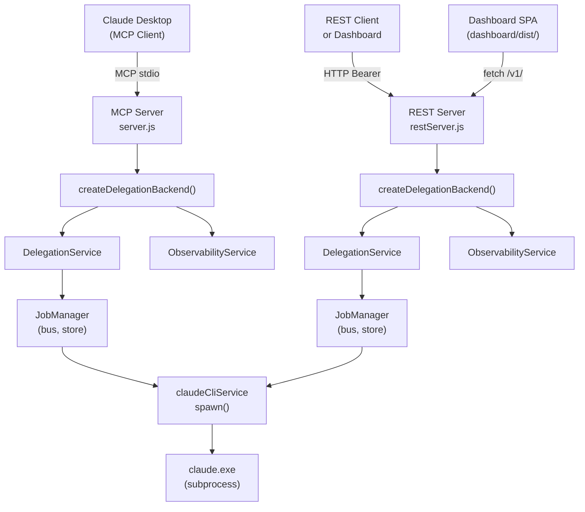
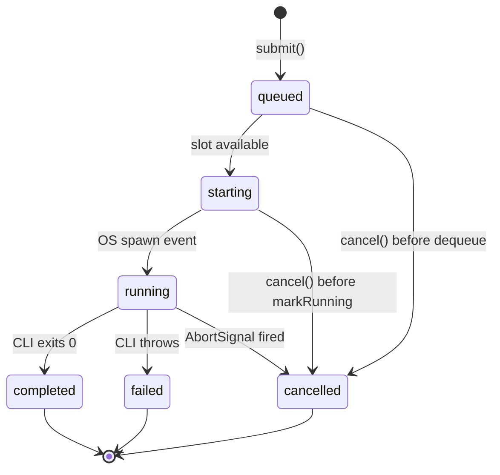
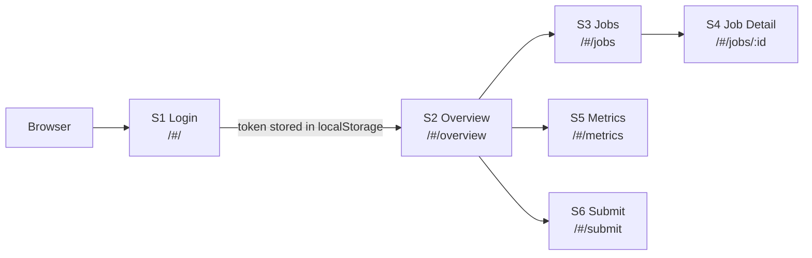

# Delegate-MCP — Project Overview

> **Language**: 🇺🇸 English (Canonical) · [🇸🇦 العربية](../ar/PROJECT_OVERVIEW.md)
>
> **Version**: v2.9.2 · **License**: Apache-2.0 · **Status**: Fully Certified

---

## Executive Summary

Delegate-MCP is a Model Context Protocol (MCP) server for Claude Desktop that hands tasks off to a headless Claude Code CLI session running in the background. It enables Claude Desktop's primary AI session to spawn and supervise a second, independent Claude Code CLI process — the delegate — without requiring a separate Anthropic API key or any billing beyond the user's existing Claude subscription.

The server exposes nine MCP tools covering task submission, job lifecycle management, history retrieval, cancellation, and observability. As of v2.8.0, a fully independent REST transport sits alongside the MCP interface, calling the same internal services. As of v2.9.0, a React SPA Dashboard is served directly from the REST server, providing a browser-based operator interface.

All public contracts — MCP tool schemas, job lifecycle states, REST routes, and the observability surface — are frozen and documented in dedicated freeze documents. The project is distributed as a locally-run server, installed via GitHub clone, and deployed via `node server.js` (MCP) or `node restServer.js` (REST + Dashboard).

---

## The Problem

Claude Desktop runs a single, interactive AI session. That session can issue instructions, analyze code, and call MCP tools — but it cannot natively launch a second Claude Code CLI process, track its progress, inspect its outputs, or cancel it on demand.

Without Delegate-MCP, the only way to run a background Claude Code task is to open a separate terminal, run `claude -p "..."` manually, and wait. There is no structured way to:

- Submit a prompt to the CLI and get a job identifier back immediately.
- Poll for status while the CLI runs.
- Cancel an in-flight job.
- Inspect what the CLI produced without leaving the Claude Desktop session.
- Expose job history, live metrics, or replay data to other consumers.

Delegate-MCP fills this gap by acting as a structured, observable wrapper around the `claude` binary already installed on the user's machine.

---

## Core Idea

The core idea is a transport-agnostic execution layer with two submission paths and one job store.

```
Claude Desktop (MCP client)
        │
        │  MCP stdio transport
        ▼
  Delegate-MCP (server.js)
        │
        ├─ DelegationService.submit() ─► JobManager ─► claudeCliService.invoke()
        │                                    │
        │                                    ▼
        │                              claude.exe (subprocess)
        │
        └─ ObservabilityService (read-only bus consumer)
```

Both the MCP tools and the REST API call the same two internal services:

- **`DelegationService`** — write side: submit, get, list, cancel jobs.
- **`ObservabilityService`** — read side: metrics, timeline, replay, snapshot.

There is exactly one write path into the job store (`JobManager.submit()` → `_run()` → `_transition()`). No component bypasses it. No component shares job state across processes by default.

---

## High-Level Architecture



Key architectural facts:

- MCP and REST are **separate processes** by default. Each calls `createDelegationBackend()` independently and gets its own `JobManager`, event bus, and `ObservabilityService`. They do not share in-memory state.
- The Dashboard SPA is served directly from the REST server at `/dashboard/` — it is a static React application that calls `/v1/` REST endpoints.
- `claudeCliService` spawns `claude.exe` with **no shell** — `prompt` is never interpreted by a shell, regardless of its contents.

---

## End-to-End Execution

### Synchronous path (`delegate_task`)

1. Claude Desktop calls `delegate_task` with a `prompt` and optional `model`, `effort`, `workingDirectory`, `allowedTools`, `timeoutMs`, `maxBudgetUsd`.
2. The MCP handler validates the input via `DelegateTaskInputSchema` (zod).
3. `DelegationService.submit()` builds an `ExecutionContext` and calls `JobManager.submit()`.
4. `JobManager` creates a `Job` (status: `queued`), enqueues it, and returns the `job_id` immediately.
5. `delegate_task` calls `jobManager.waitForCompletion(job_id)` and blocks.
6. When a concurrency slot opens, `JobManager` dequeues the job (status: `starting`) and calls `claudeCliService.invoke()`.
7. On the OS `spawn` event, the job transitions to `running`.
8. `claudeCliService` reads `--output-format stream-json` stdout chunks, parses them incrementally, and publishes `JobProgress` events to the `RuntimeEventBus`.
9. On completion, the job transitions to `completed` (or `failed`), `waitForCompletion` resolves, and `delegate_task` returns the CLI result to Claude Desktop.

### Asynchronous path (`delegate_submit`)

Steps 1–4 are identical. At step 5, `delegate_submit` returns `{success: true, job_id, status}` immediately without waiting. The caller uses `delegate_status` to poll, and `delegate_cancel` to abort.

---

## Internal Request Lifecycle



**State invariants:**

- `startedAt` is set once (at `starting`) and never reset.
- Terminal states (`completed`, `failed`, `cancelled`) are immutable. `cancelJob()` on a terminal job always returns `false`.
- `runtimeMs` is live-computed for non-terminal jobs (`Date.now() - startedAt`), frozen once terminal.
- History is bounded by `maxJobHistory` (default 500). Only terminal jobs are evicted; in-flight jobs are never evicted.

---

## Dashboard

The Dashboard is a React 18 SPA (Single Page Application) served from the REST server at `GET /dashboard/*`. It provides a browser-based operator interface for the REST API.



| Screen | Route | Primary REST Call |
|--------|-------|-------------------|
| S1 Login | `/#/` | — (token entry only) |
| S2 Overview | `/#/overview` | `GET /v1/snapshot` (poll 5 s) + `GET /v1/models` (once) |
| S3 Jobs | `/#/jobs` | `GET /v1/jobs?status=&limit=` (poll 5 s) |
| S4 Job Detail | `/#/jobs/:id` | `GET /v1/jobs/:id` (poll 2 s) + `DELETE /v1/jobs/:id` + `GET /v1/jobs/:id/replay` |
| S5 Metrics | `/#/metrics` | `GET /v1/metrics` (poll 5 s) |
| S6 Submit | `/#/submit` | `POST /v1/jobs` |
| S7 Models | `/#/models` | `GET /v1/models` (once) |

**Authentication:** The bearer token is entered once on the Login screen and stored in `localStorage` under the key `delegate-rest-token`. It is injected as `Authorization: Bearer <token>` on every API call. On a `401` response, the client clears the token and redirects to Login.

**Security invariant (RC6):** All job-produced text fields — result, error, `progressMessage`, `promptPreview`, phase, metadata — are rendered via React JSX as plain text (`textContent`). `innerHTML` and `dangerouslySetInnerHTML` are never used anywhere in `dashboard/src/`. This constraint applies to every screen, every version.

**Static serving:** `GET /dashboard/*` is handled before the REST auth gate — static assets are intentionally unauthenticated. The config stub at `GET /dashboard/config.js` injects `window.__DELEGATE_REST__` (base URL) before `main.jsx` loads.

**Build:** The Dashboard is a Vite build (`npm --prefix dashboard run build`). The `dashboard/dist/` directory is not committed to git (see ADR-0012).

---

## REST API

The REST API is the second transport, introduced in v2.8.0 (ADR-0011). It is entirely opt-in — the REST server (`node restServer.js`) is a separate process from the MCP server (`node server.js`).

Base path: `/v1`. All responses: `application/json`. Authentication: `Authorization: Bearer <token>` required on every route, including reads.

### Route Table (frozen)

| Method | Path | Service Call | Status Codes | Notes |
|--------|------|-------------|--------------|-------|
| `POST` | `/v1/jobs` | `delegationService.submit()` | 202 | Returns `{job_id, status}` + `Location` header |
| `GET` | `/v1/jobs/:id` | `delegationService.getJob(id)` | 200, 404 | `Retry-After: 2` while non-terminal |
| `GET` | `/v1/jobs` | `delegationService.listJobs({status, limit})` | 200 | `limit` default 20, max 500 |
| `DELETE` | `/v1/jobs/:id` | `delegationService.cancelJob(id)` | 200, 404, 409 | 409 = already terminal |
| `GET` | `/v1/jobs/:id/replay` | `observabilityService.replay(id)` | 200 always | Never 404; source may be `"unavailable"` |
| `GET` | `/v1/jobs/:id/timeline` | `observabilityService.getTimeline(id, {type, since})` | 200 | No `source` field; REST-only (no MCP mirror) |
| `GET` | `/v1/metrics` | `observabilityService.getMetrics()` | 200 | Process-scoped |
| `GET` | `/v1/snapshot` | `observabilityService.getSnapshot()` | 200 | Point-in-time |
| `GET` | `/v1/models` | `buildModelsInfo(config)` | 200 | `{models, efforts, defaults}` |

**`POST /v1/jobs` is always async.** There is no REST equivalent of `delegate_task`'s blocking behavior. Callers poll `GET /v1/jobs/:id` and honor the `Retry-After: 2` header.

### Error model (frozen)

One JSON shape across all routes: `{error: {code, message, details?}}`.

| Condition | Status | Code |
|-----------|--------|------|
| Unknown job id | 404 | `JOB_NOT_FOUND` |
| No such route | 404 | `NOT_FOUND` |
| Job already terminal | 409 | `JOB_NOT_CANCELLABLE` |
| Invalid body (zod) | 400 | `INVALID_INPUT` |
| Bad query param | 400 | `INVALID_QUERY_PARAM` |
| Malformed JSON | 400 | `MALFORMED_BODY` |
| Body > 1 MiB | 413 | `PAYLOAD_TOO_LARGE` |
| Missing/wrong token | 401 | `UNAUTHORIZED` |
| Internal error | 500 | `INTERNAL_ERROR` |

**Auth:** Token generated at first boot if unset, persisted to `.delegate-rest-token`, compared with `crypto.timingSafeEqual`. Required on every route.

---

## MCP Protocol

Delegate-MCP implements the Model Context Protocol over a stdio transport. Claude Desktop connects via `claude_desktop_config.json` pointing at `server.js`.

### Nine MCP Tools (frozen)

| Tool | Type | Description |
|------|------|-------------|
| `delegate_task` | Blocking | Submit prompt, wait for completion, return result |
| `delegate_submit` | Non-blocking | Submit prompt, return job_id immediately |
| `delegate_status` | Read | Get current job state |
| `delegate_history` | Read | List jobs with optional status/limit filter |
| `delegate_cancel` | Write | Cancel a queued or running job |
| `delegate_models` | Read | Introspect available models, efforts, and defaults |
| `delegate_replay` | Read | Reconstruct a job's full event history |
| `delegate_metrics` | Read | Retrieve accumulated process metrics |
| `delegate_snapshot` | Read | Get point-in-time metrics + active jobs snapshot |

**Input schema (shared by `delegate_task` and `delegate_submit`):**

| Field | Type | Default | Notes |
|-------|------|---------|-------|
| `prompt` | string | required | Arbitrary text; never shell-interpreted |
| `model` | string | config default | Claude model identifier |
| `effort` | enum | config default | `low` / `normal` / `high` |
| `workingDirectory` | string | `process.cwd()` | Working directory for the CLI session |
| `allowedTools` | string[] | — | MCP tool allow-list for the delegate session |
| `trustAll` | boolean | false | Equivalent to `--dangerously-skip-permissions` |
| `timeoutMs` | number | config default | Job timeout in milliseconds |
| `maxBudgetUsd` | number (positive) | — | Spend cap; zero/negative rejected by zod |
| `metadata` | object | — | Caller-supplied context, returned in `delegate_status` |

---

## Claude Code CLI Integration

Delegate-MCP invokes the `claude` binary via Node.js `spawn()`. The CLI integration is encapsulated entirely in `src/services/claudeCliService.js`.

**Argument construction:**

- `--print` — non-interactive mode (equivalent to `claude -p`)
- `--output-format stream-json --verbose` — required for incremental progress
- `--model <model>` — from `ExecutionContext.model`
- `--max-turns 1` — prevents the CLI from requesting further input
- Budget, effort, tool allow-list, and trust flags from `ExecutionContext`

**Stream parsing:** The CLI outputs `stream-json` format: one JSON object per line. `claudeCliService.js` buffers chunks incrementally via `streamJsonParser.js` and classifies events:

- `system/thinking_tokens` → `JobProgress` ("Thinking… (~N tokens)")
- `assistant` with a `text` content block → `JobProgress` (response text)
- `type:"result"` → terminal result, field-for-field identical to the old non-streaming `json` format
- All other events (hooks, session bookkeeping, `tool_use`, unrecognized shapes) → silently skipped

`delegate_task`'s response shape is unaffected by the streaming transport — callers always receive the same `{isError, content, structuredContent}` result structure.

**No shell:** `claudeCliService.invoke()` spawns `config.claudeBin` directly with `shell: false`. `config.claudeBin` must point at the real `claude.exe`, not the `.cmd`/`.bat` shim. A shell would re-parse `prompt` for metacharacters (`&`, `|`, `` ` ``) — a command injection vector.

**Buffer protection:** `spawnAndCollect()` enforces `config.maxBufferBytes` manually on every chunk. The child is killed the moment either stdout or stderr exceeds the limit.

**Windows process-tree cleanup:** On abort or timeout, `taskkill /t /f` is run against the spawned process tree to kill any grandchild processes (e.g. Bash tool calls still running when the job was cancelled).

---

## Security Model

Security properties are structural — enforced by the code, not by convention.

| Property | Mechanism | Location |
|----------|-----------|----------|
| No shell injection | `spawn(bin, args, {shell: false})` — `prompt` is one literal argv entry | `claudeCliService.js` |
| Path safety | `isValidJobId()` UUID check before any filesystem path join | `workspaceManager.js` |
| Secret redaction | `ExecutionContext.environment` (= `process.env`) never written to disk or MCP response | `delegationService.js`, `workspaceManager.js` |
| Timing-safe auth | `crypto.timingSafeEqual()` for bearer token comparison | `src/rest/auth.js` |
| Auth before routing | Route existence not observable to unauthenticated callers | `src/rest/restServer.js` |
| No XSS in Dashboard | All job text rendered via React JSX (`textContent`); `innerHTML`/`dangerouslySetInnerHTML` absent from `dashboard/src/` | RC6 invariant, PR checklist |
| Buffer overflow protection | `maxBufferBytes` checked on every stdout/stderr chunk; child killed on excess | `claudeCliService.js` |
| Read-only Observability | `ObservabilityService` holds no reference to `JobManager`, CLI, or `bus.publish` | `observabilityService.js` |
| Windows process-tree cleanup | `taskkill /t /f` on abort/timeout (win32 only) | `claudeCliService.js` |

---

## Replay System

The Replay system reconstructs a job's full event history in read-only mode. It is exposed via:

- **MCP**: `delegate_replay` tool
- **REST**: `GET /v1/jobs/:id/replay`

`ReplayEngine.replay(jobId)` attempts three tiers in order:

```
1. runtime  — TimelineStore (in-memory, most recent jobs, full fidelity)
      ↓
2. durable  — EventHistoryStore (<job-id>.jsonl, opt-in via CLAUDE_DELEGATE_EVENT_HISTORY=file)
      ↓
3. workspace — metadata.json (coarse, synthetic: true, survives restarts)
      ↓
4. unavailable — job never existed or workspace was pruned
```

The response always includes a `source` field indicating which tier was used. The `timeline` array is the same `RuntimeEvent[]` shape regardless of source tier. Synthetic workspace entries are marked `synthetic: true`.

**Durable replay:** When `CLAUDE_DELEGATE_EVENT_HISTORY=file` is enabled, `EventHistoryStore` appends every `RuntimeEvent` to a per-job `<job-id>.jsonl` file. This provides full-fidelity replay for any job ever recorded, even after the process restarts or the job leaves `TimelineStore`'s retention window.

---

## Observability

`ObservabilityService` is a passive, read-only consumer of the `RuntimeEventBus`. It cannot mutate job state, cancel a job, or execute anything — the Passive Observation Rule is structural: it holds no reference to `JobManager`, `claudeCliService`, or `bus.publish`.

The service provides four methods:

| Method | Consumer | Data |
|--------|----------|------|
| `getMetrics()` | `delegate_metrics`, `GET /v1/metrics` | O(1) incremental aggregates since boot |
| `getTimeline(id, opts)` | `GET /v1/jobs/:id/timeline` (REST only) | Per-job bounded event list |
| `replay(id)` | `delegate_replay`, `GET /v1/jobs/:id/replay` | Full-fidelity event reconstruction |
| `getSnapshot()` | `delegate_snapshot`, `GET /v1/snapshot` | Point-in-time `{takenAt, metrics, activeJobs}` |

**Metrics** are O(1) incremental aggregates — no stored history arrays. `MetricsCollector` computes workspace size and artifact count from disk on demand (only when `getMetrics()` is called), reusing `workspaceManager.getWorkspaceRoot()`.

**Snapshots** are `structuredClone()` + recursively `Object.freeze()`d. They are immutable once returned. `activeJobs` is sourced from `MetricsCollector.getActiveJobs()` (event-derived, not a `JobManager` query).

**Process scope:** Metrics and snapshots are scoped to the process that collected them. A REST process and an MCP process accumulate independent metric counters — there is no cross-process aggregation.

---

## Architecture Decisions

Twelve ADRs govern the project's architecture. Each represents a reviewed, accepted decision:

| ADR | Title | Key decision |
|-----|-------|-------------|
| ADR-0001 | Workspace and Artifact Architecture | Per-job on-disk artifact trail; workspace is write-once, never authoritative |
| ADR-0002 | Streaming and Event Architecture | `RuntimeEventBus` as the event spine; `stream-json` for CLI output |
| ADR-0003 | Observability Architecture | Passive observation rule; `ObservabilityService` holds no write references |
| ADR-0004 | Server Instance Lifecycle | stdin-close as a third graceful-shutdown trigger |
| ADR-0005 | Persistent Job Store | `FileJobStore` as opt-in alternative to `InMemoryJobStore` |
| ADR-0006 | Persistent Event History | `EventHistoryStore` (`<job-id>.jsonl`) for durable full-fidelity replay |
| ADR-0007 | MCP Replay Access | `delegate_replay` as thin transport adapter over `replay()` |
| ADR-0008 | MCP Metrics Access | `delegate_metrics` as thin transport adapter over `getMetrics()` |
| ADR-0009 | MCP Snapshot Access | `delegate_snapshot` as thin transport adapter over `getSnapshot()` |
| ADR-0010 | Unified Access Layer | `DelegationService` + `ObservabilityService` as the two stable internal APIs |
| ADR-0011 | REST API Foundation | Opt-in REST transport; same two services; nine routes frozen |
| ADR-0012 | Dashboard Stage 3 | React SPA served from REST server; polling (not SSE); RC6 security invariant |

---

## What Delegate-MCP Is NOT

| Claim | Reality |
|-------|---------|
| A distributed task queue | Single-process, single-machine. No clustering. No cross-process job sharing by default. |
| A multi-user system | One bearer token. Any caller with the token can see and cancel any job. |
| An API key alternative | Requires `claude` CLI already installed and logged into the user's subscription. No Anthropic API key path. |
| A streaming response server | No SSE. REST clients poll `GET /v1/jobs/:id` at their own cadence. |
| A persistent-first system | In-memory job store by default. Opt-in file persistence via `CLAUDE_DELEGATE_JOB_STORE=file`. |
| An npm package | `"private": true`. Distributed via GitHub clone, not the npm registry. Not suitable as a dependency. |
| A proxy or relay | Submits to the local `claude` binary directly. Does not call any Anthropic HTTP API. |
| A production service | No clustering, no HA, no multi-tenant auth, no rate limiting. Designed for single-operator local use. |

---

## Typical Use Cases

**1. Delegate a long-running analysis task**

The primary Claude Desktop session needs to run a large codebase analysis that would block its own context window. It calls `delegate_submit` with the analysis prompt, receives a `job_id`, continues its own work, then polls `delegate_status` until the job is `completed`, and retrieves the result.

**2. Run background tasks in parallel**

`JobManager` allows up to `maxConcurrentJobs` (default 2) tasks running simultaneously. An orchestrating session can submit multiple `delegate_submit` calls and use `delegate_history` to track all in-flight jobs.

**3. Monitor a running task via the Dashboard**

The operator opens the Dashboard at `http://localhost:8787/dashboard/`. After entering the bearer token on the Login screen, they navigate to the Jobs list to watch in-flight jobs, open Job Detail to see live progress messages and the Replay timeline, and cancel jobs if needed.

**4. Inspect past jobs via Replay**

After a job completes, the operator calls `delegate_replay` (via MCP or `GET /v1/jobs/:id/replay` via REST) to see the full event timeline — `JobQueued`, `JobStarted`, `JobProgress` (thinking tokens, response text), `JobCompleted`. With `CLAUDE_DELEGATE_EVENT_HISTORY=file` enabled, replay is available even after a process restart.

**5. Integrate the REST API into a script or CI pipeline**

An external script submits a job via `POST /v1/jobs`, polls `GET /v1/jobs/:id` until terminal, reads the `result` field from the `JobView`, and exits. The script never interacts with Claude Desktop directly.

---

## Repository Layout

```
claude-delegate-mcp/
│
├── server.js               MCP entry point (stdio transport)
├── restServer.js           REST entry point (HTTP transport)
│
├── src/
│   ├── cli/
│   │   ├── entry.js        MCP boot: config load, health check, start, shutdown
│   │   └── restEntry.js    REST boot: main(), buildRouteTable(), shutdown handlers
│   │
│   ├── server/
│   │   ├── mcpServer.js    McpServer instance; registers all 9 MCP tools
│   │   └── health.js       Non-blocking check that claude binary exists
│   │
│   ├── handlers/           One file per MCP tool (input validation → service call → response)
│   │
│   ├── rest/
│   │   ├── restServer.js   Request pipeline: dashboard → body-limit → auth → route → handler
│   │   ├── router.js       Pure path matcher (no I/O)
│   │   ├── auth.js         Bearer token check + generation/persistence
│   │   ├── bodyLimit.js    Content-Length pre-check
│   │   ├── errors.js       Unified error mapping
│   │   ├── parsing.js      Query-param validation
│   │   ├── dashboard.js    Static file serving + /dashboard/config.js injection
│   │   └── routes/
│   │       ├── jobs.js         POST /v1/jobs, GET/DELETE /v1/jobs/:id, GET /v1/jobs
│   │       ├── observability.js GET /v1/jobs/:id/replay, /timeline, /metrics, /snapshot
│   │       └── models.js       GET /v1/models
│   │
│   ├── services/
│   │   ├── delegationBackend.js  createDelegationBackend() — shared construction
│   │   ├── delegationService.js  DelegationService: submit/getJob/listJobs/cancelJob
│   │   ├── claudeCliService.js   spawn()-based CLI invocation; stream-json parsing
│   │   ├── jobManager.js         Queue, concurrency, lifecycle, event bus integration
│   │   ├── jobStore.js           InMemoryJobStore (default)
│   │   ├── fileJobStore.js       FileJobStore (opt-in)
│   │   ├── runtimeEventBus.js    RuntimeEventBus contract + EventEmitter implementation
│   │   ├── observabilityService.js ObservabilityService (read-only bus consumer)
│   │   ├── metricsCollector.js   O(1) incremental metrics
│   │   ├── timelineStore.js      Per-job bounded event history
│   │   ├── replayEngine.js       Tiered job-history reconstruction
│   │   ├── snapshotBuilder.js    Immutable point-in-time snapshots
│   │   ├── workspaceManager.js   Per-job on-disk artifact mirror
│   │   ├── eventHistoryStore.js  Per-job <job-id>.jsonl (opt-in)
│   │   ├── debugInvoke.js        Debug Mode: visible terminal execution
│   │   └── debugTerminalLauncher.js Per-OS terminal detection and launch
│   │
│   ├── models/
│   │   ├── schemas.js      Zod input schema (DelegateTaskInputShape, frozen)
│   │   ├── executionContext.js ExecutionContext shape + factory
│   │   ├── job.js          Job shape, status enum, toJobView()
│   │   └── runtimeEvent.js EVENT_TYPES enum + RuntimeEvent shape
│   │
│   ├── config/             Env-driven config loading + version constant
│   ├── validation/         Startup config sanity checks
│   ├── logging/            Structured JSON logs to stderr
│   └── utils/              Shared error types + MCP response formatting
│
├── dashboard/              React 18 SPA (Vite; dashboard/dist/ not committed)
│
├── tests/                  node:test unit + integration tests (466 passing)
│
└── docs/
    ├── adr/                12 Architecture Decision Records
    ├── releases/           Release notes, baselines, known limitations
    ├── en/                 English documentation
    └── ar/                 Arabic documentation
```

---

## Extension Guide

The architecture defines clear extension points. All follow the same pattern: implement an interface, inject it at construction, change nothing else.

### 1. Custom Job Store

Implement the four-method `JobStore` interface:

```js
// src/services/jobStore.js interface
create(job)       → Promise<Job>
get(id)           → Promise<Job | null>
update(id, patch) → Promise<Job>
list(filter)      → Promise<Job[]>
```

Pass it to `JobManager` at construction: `new JobManager({ store: myStore })`. `FileJobStore` is the reference implementation.

### 2. Additional ObservabilityService Consumers

Subscribe to the `RuntimeEventBus` via `bus.subscribeAll(handler)`. The handler receives every `RuntimeEvent` as it is published. The bus guarantees fail-safe isolation — a subscriber that throws does not affect other subscribers or the job lifecycle.

Example consumer types designed in ADR-0003: Prometheus exporter, Grafana adapter, VS Code extension, CLI dashboard, plugin SDK.

### 3. New REST Routes

New routes must go through a new ADR (ADR-0013+). The REST contract is frozen at nine routes. No new routes may be added without an accepted ADR. See `docs/REST_FREEZE.md`.

### 4. New MCP Tools

New tools must be thin transport adapters over `DelegationService` or `ObservabilityService` — no business logic in the handler. See `docs/FOUNDATION_FREEZE.md` for what "thin adapter" means in practice.

### 5. New Transport

Call `createDelegationBackend()` to get the two internal services, implement a new request/response mapping layer on top, and pass in the same `ExecutionContext` shape. The CLI service and `JobManager` are unchanged.

---

## Known Limitations

All limitations below are verified and disclosed. None are speculation.

| # | Limitation | Status |
|---|-----------|--------|
| 1 | Replay fidelity degrades to coarse once a job leaves `TimelineStore`'s window, unless `CLAUDE_DELEGATE_EVENT_HISTORY=file` is enabled | Accepted; workaround: enable durable replay |
| 2 | Stream-json real-world verification limited to 2 CLI captures + 1 live run. Unobserved shapes (`tool_use`, multi-turn) are silently skipped | Accepted; no crash risk |
| 3 | stdin-close self-shutdown verified via unit tests only, not against a real Claude Desktop disconnect | Known; operating mitigation: issue `delegate_*` calls one at a time |
| 4 | REST metrics/snapshots are process-scoped. No cross-process aggregation exists | Accepted; by design |
| 5 | `POST /v1/jobs` body limit is 1 MiB. Identical `prompt` via MCP has no length limit | Accepted; disclosed REST/MCP asymmetry |
| 6 | Ungraceful shutdown (`kill -9`, crash) on Windows may orphan subprocess trees | Accepted; same limit as MCP path |
| 7 | Any caller with the bearer token can see and cancel any job. No per-job ownership scoping | Accepted; matches MCP trust model |
| 8 | `FileJobStore` hydrates once at boot. Jobs submitted after REST start (from a concurrent MCP session) are invisible to that REST process until restart | Accepted; single-process assumption unchanged |

---

## Future Evolution

Extensions designed in prior ADRs but not yet implemented:

- **SSE (Server-Sent Events)**: `useJobSubscription` currently polls every 2 s. Upgrading to SSE changes only the hook internals; no screen changes required. Requires a new ADR.
- **`ConsumerRegistry` auto-expiry sweep**: `pruneStale(maxAgeMs)` exists; no consumer calls it yet. Deferred.
- **Additional Dashboard screens**: S1–S7 are implemented. Future screens (analytics, search, configuration) require a new ADR.
- **Prometheus / Grafana integration**: `ObservabilityService` exposes the surface; no exporter exists.
- **VS Code extension**: contract designed in ADR-0003; not implemented.
- **Plugin SDK**: future consumers depend only on `ObservabilityService`; no plugin system exists yet.
- **Per-job ownership / multi-credential auth**: explicitly deferred; must be decided before issuing more than one distinct REST credential.
- **Cross-process metrics aggregation**: requires new persistence mechanism; no concrete consumer demand yet.
- **Branch protection on `main`**: PUBLISHING_CHECKLIST.md recommends requiring CI to pass before merge; not yet enacted in GitHub Settings.

All future work begins through a new ADR (ADR-0013+) before any implementation plan.

---

## Executive One-Page Summary

**What it is:** A locally-run MCP server that wraps the `claude` CLI binary with a structured, observable job system. Installed via GitHub clone. No API key required. Uses the user's existing Claude subscription.

**Two transports, one backend:**

- **MCP** (stdio): Claude Desktop connects here. Nine tools. `delegate_task` blocks; `delegate_submit` is async.
- **REST** (HTTP port 8787): Separate process. Nine routes. Always async (`POST /v1/jobs` → poll `GET /v1/jobs/:id`). Dashboard served at `/dashboard/`.

**Job lifecycle:** `queued → starting → running → {completed | failed | cancelled}`. Terminal states are immutable. In-flight jobs are never evicted.

**Observability:** `ObservabilityService` is a passive bus consumer. It provides metrics, per-job timelines, tiered replay (runtime → durable → workspace → unavailable), and point-in-time snapshots. All read-only. Can never mutate job state.

**Security:** No shell. UUID path gate. Secret redaction. Timing-safe auth. No XSS (`textContent` only in Dashboard). Buffer limit. Read-only observability by construction.

**Frozen contracts:** MCP tool schemas, job lifecycle, REST routes, observability surface — all frozen in `docs/FOUNDATION_FREEZE.md`, `docs/REST_FREEZE.md`, `docs/OBSERVABILITY_FREEZE.md`. Any change requires a new ADR.

**Certification:** FULLY CERTIFIED (2026-07-18). Apache-2.0. 574/574 tests. 12 ADRs. Zero outstanding findings.
